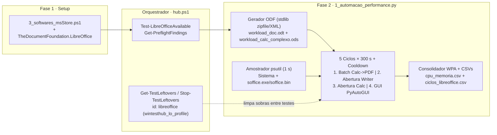

# Plano Técnico — 001: Módulo 1 com workloads locais no LibreOffice

## 1. Arquitetura e visão geral do delta

A feature substitui a dependência de Microsoft Edge + Selenium + Google Docs/Sheets no Módulo 1 (`Testes/1_cpu_memo/1_automacao_performance.py`) por automação 100% local do **LibreOffice** (`soffice.exe` / `soffice.bin`), mantendo a arquitetura de 5 ciclos de 300 s com captura WPR (`wpr.exe`), exportação WPA (`wpaexporter.exe` com `Agentes_SI_Profile.wpaProfile`), parada segura (`Ctrl+Q` + `HUB_STOP_FILE`), overlay Tkinter click-through e cooldown inteligente.



## 2. Camadas afetadas

### 2.1. Módulo Python e geração de fixtures ODF (`Testes/1_cpu_memo/1_automacao_performance.py`)

1. **Remoção do Selenium e Edge:**
   - Remover todas as importações de `selenium.*` e funções `_configure_edge_startup_setting`, `kill_edge`, `_get_current_tab_url`, `_check_edge_welcome_screen`, `_check_google_login_screen`, `_pause_for_edge_login`, `_pause_for_google_login`, `_check_extra_tabs` e `open_edge_and_verify`.
2. **Descoberta do `soffice.exe` (`find_libreoffice_executable()`):**
   - Retorna o caminho do `soffice.exe` seguindo a ordem do contrato: `os.environ.get("HUB_LIBREOFFICE_PATH")`, `shutil.which("soffice.exe")`, `shutil.which("soffice")`, `r"C:\Program Files\LibreOffice\program\soffice.exe"`, `r"C:\Program Files (x86)\LibreOffice\program\soffice.exe"`.
   - Em `check_prerequisites()`, substitui a checagem do Microsoft Edge pela validação de `find_libreoffice_executable()`; se retornar `None`, adiciona erro fatal (`"LibreOffice (soffice.exe) nao encontrado no sistema — execute o Setup 3_softwares_msStore.ps1."`) e levanta `EnvironmentError`.
3. **Gerador determinístico de arquivos ODF (`generate_odf_fixtures(work_dir)`):**
   - Usa apenas `zipfile`, `os` e `random.Random(42)` (funções puras e importáveis sem iniciar Tkinter, para permitir teste unitário no Linux/Windows CI).
   - No padrão ODF 1.2, o arquivo `mimetype` deve ser a **primeira entrada** do ZIP, gravada com `compress_type=zipfile.ZIP_STORED`, seguido de `META-INF/manifest.xml` e `content.xml` com `ZIP_DEFLATED`.
   - `workload_doc.odt`: documento de texto com título e 20 parágrafos iniciais baseados em `TYPING_SAMPLES`.
   - `workload_calc_complexo.ods`: planilha com 1 linha de cabeçalho (`Departamento`, `Receita`, `Despesa`, `Imposto_Taxa`, `Indice_Lookup`, `Saldo_Liquido`, `Status_Margem`, `Media_Movel_50`, `Busca_Cruzada`, `Contagem_Acima`) e 5.000 linhas de dados (`r = 2..5001`) com as 5 fórmulas OpenFormula (`of:=...`) especificadas no contrato da `spec.md`.
4. **Isolamento de perfis e controle de processos do LibreOffice:**
   - Prefixo identificador: `LO_PROFILE_PREFIX = "wintesthub_lo_profile"`.
   - Para cada ciclo, cria diretório temporário contendo 3 subpastas de perfil (`wintesthub_lo_profile_batch`, `wintesthub_lo_profile_writer`, `wintesthub_lo_profile_calc`), convertidas para URI `file:///` com `os.path.abspath(p).replace("\\", "/")`.
   - `kill_test_libreoffice(ui=None, run_index=0)`: percorre `psutil.process_iter(['pid', 'name', 'cmdline'])` e encerra apenas processos `soffice.exe` / `soffice.bin` cujo `cmdline` contenha `wintesthub_lo_profile` (usando `terminate()` seguido de `kill()` após 3 s), preservando qualquer instância do LibreOffice aberta pelo usuário fora do teste.
5. **Medição das 4 etapas em cada ciclo (`run_test_cycle`):**
   - **Amostrador `psutil` em thread (`ResourceSampler`):** inicia junto com a captura WPR e coleta a cada `1.0 s`:
     - `psutil.cpu_percent(interval=None)` e `psutil.virtual_memory()` (usado em MB = `mem.used / (1024**2)` e percentual = `mem.percent`).
     - Soma de `proc.cpu_percent(interval=None) / logical_cpus` e soma de `proc.memory_info().rss / (1024**2)` para todos os processos `soffice.exe`/`soffice.bin` ativos com `wintesthub_lo_profile` no `cmdline`.
   - **Etapa 1 — Cálculo pesado (`measure_formula_calculation`):** copia `workload_calc_complexo.ods` para pasta do ciclo e executa:
     `[soffice_path, f"-env:UserInstallation={uri_batch}", "--headless", "--norestore", "--nologo", "--nodefault", "--nolockcheck", "--convert-to", "pdf", "--outdir", cycle_dir, ods_copy]` com `timeout=180`. Mede `time.perf_counter()` do início ao retorno `returncode == 0` e valida que o `.pdf` gerado existe e tem `os.path.getsize(pdf_path) > 0`.
   - **Etapa 2 — Abertura do Writer (`measure_app_launch(..., mode="--writer", file_path=odt_copy, profile_uri=uri_writer)`):** inicia via `subprocess.Popen` e aguarda até que um processo `soffice.bin` com `uri_writer` no `cmdline` esteja rodando e possua janela visível (`ctypes.windll.user32.EnumWindows` + `IsWindowVisible` + `GetWindowThreadProcessId` no Windows) por 0,5 s, retornando `(elapsed_seconds, pid, hwnd)` (timeout 60 s).
   - **Etapa 3 — Abertura do Calc (`measure_app_launch(..., mode="--calc", file_path=ods_gui_copy, profile_uri=uri_calc)`):** idem com `uri_calc`, retornando `(elapsed_seconds, pid, hwnd)` (timeout 60 s).
   - **Etapa 4 — Simulação GUI no restante dos 300 s:** alterna entre `hwnd_writer` e `hwnd_calc` (usando `ctypes.windll.user32.SetForegroundWindow(hwnd)` com fallback `Alt+Tab` e clique na área segura `_click_safe_content_area()`):
     - No Writer: digita parágrafos (`type_text_safely`), aplica negrito ocasional (`Ctrl+A`, `Ctrl+B`, seta Fim), salva (`Ctrl+S`) e incrementa `paragrafos_digitados`.
     - No Calc: foca grade (`_ensure_grid_focus`), navega para próxima linha, preenche linha de `_SHEET_DATA_POOL` (`_write_row`), dispara recálculo (`Ctrl+Shift+F9`), salva (`Ctrl+S`) e incrementa `linhas_editadas`.
6. **Consolidação e CSVs (`consolidate_results`):**
   - Deve ser chamada sempre ao fim dos 5 ciclos, mesmo quando `Agentes_SI_Profile.wpaProfile` não estiver presente (nesse caso, processa `summary_data = []` para a parte WPA, mas sempre grava `ciclos_libreoffice.csv`, `cpu_memoria.csv` e `Resultados_Consolidados/Relatorio_Resumo.html`).
   - Para cada CSV do WPA, além de `Media`, `Maximo` e `Minimo` por processo, calcula `Soma_Media` (`df_final[media_col].sum()`), gravando `WPA_<Arquivo>_<Metrica>_Soma_Media` em `cpu_memoria.csv`.

### 2.2. Setup e Orquestrador PowerShell (`Setup/environment/3_softwares_msStore.ps1`, `hub.ps1`, `.github/scripts/Test-Preflight.ps1`)

1. **`Setup/environment/3_softwares_msStore.ps1`:**
   - Adicionar `"TheDocumentFoundation.LibreOffice"` na lista `$apps` (e atualizar o cabeçalho de comentário do script).
2. **`hub.ps1`:**
   - Criar a função de sonda `Test-LibreOfficeAvailable` logo abaixo de `Test-CommandAvailable`:
     ```powershell
     function Test-LibreOfficeAvailable {
         if (-not [string]::IsNullOrWhiteSpace($env:HUB_LIBREOFFICE_PATH) -and (Test-Path -LiteralPath $env:HUB_LIBREOFFICE_PATH)) { return $true }
         if (Test-CommandAvailable -Cmd "soffice") { return $true }
         foreach ($p in @(
             "C:\Program Files\LibreOffice\program\soffice.exe",
             "C:\Program Files (x86)\LibreOffice\program\soffice.exe"
         )) {
             if (Test-Path -LiteralPath $p) { return $true }
         }
         return $false
     }
     ```
   - Em `Get-PreflightFindings`: quando `$byFolder.Contains("1_cpu_memo")`, filtrar apenas os testes da pasta cujo nome seja `1_automacao_performance.py` (`$loNames = @($byFolder["1_cpu_memo"] | Where-Object { $_ -match '^1_automacao_performance\.' })`). Se `$loNames.Count -gt 0 -and -not (Test-LibreOfficeAvailable)`, adicionar:
     `New-PreflightFinding "Impede" $loNames "LibreOffice (soffice.exe) nao encontrado (1_cpu_memo)" "Instale: rode o Setup 3_softwares_msStore"`
   - Em `Get-TestLeftovers`:
     - Na sobra `"edge"` (linha ~2067), alterar a lista de pastas de `@("1_cpu_memo", "3_rede", "5_bateria", "6_wifi_fast_transition")` para `@("3_rede", "5_bateria", "6_wifi_fast_transition")`.
     - Adicionar detecção de sobra `"libreoffice"`:
       ```powershell
       $lo = @($procs | Where-Object { $_.Name -match '^soffice\.(exe|bin)$' -and [string]$_.CommandLine -match '(?i)wintesthub_lo_profile' })
       $loPids = @($lo | ForEach-Object { $_.ProcessId })
       if ($loPids.Count -gt 0) {
           & $add "libreoffice" "LibreOffice da automacao" "$($lo.Count) processo(s)" $loPids @("1_cpu_memo")
       }
       ```
     - Em `Stop-TestLeftovers`, o ramo `default` (`taskkill.exe /T /F /PID $p`) já encerra automaticamente a árvore dos PIDs de `"libreoffice"`.
3. **`.github/scripts/Test-Preflight.ps1`:**
   - Incluir `"Test-LibreOfficeAvailable"` na lista de funções extraídas da AST do `hub.ps1` (ou substituir a sonda `function Test-LibreOfficeAvailable { Test-CommandAvailable -Cmd "soffice" }` junto às demais sondas na linha ~49).
   - Adicionar `soffice = "LibreOffice 24.8"` ao hashtable `$okTools` (linha ~81).
   - Adicionar asserções testando:
     - `1_automacao_performance.py` com `soffice` ausente → `Impede` mandando rodar o Setup 3;
     - `1-1_automacao_performance_dlp.py` com `soffice` ausente (e `.wpaProfile` presente) → **sem** achado de LibreOffice;
     - `Get-TestLeftovers` detecta `soffice.bin` com `wintesthub_lo_profile` (Id `libreoffice`) no filtro `-Folders @("1_cpu_memo")`, ignora `soffice.bin` comum do usuário e não inclui mais `edge` nas sobras de `1_cpu_memo`.

### 2.3. Testes de regressão Python e CI (`.github/scripts/test_cpu_memo_libreoffice.py`, `.github/workflows/ci.yml`)

- Criar `.github/scripts/test_cpu_memo_libreoffice.py` (no mesmo padrão de `.github/scripts/test_rede_estatistica.py`), importando as funções puras de `1_automacao_performance.py` (geração de `.odt`/`.ods`, consolidação de métricas e escrita de `cpu_memoria.csv` e `ciclos_libreoffice.csv`) e verificando todos os invariantes do contrato.
- Adicionar um step no job `python` de `.github/workflows/ci.yml` para rodar `python -I -X utf8 .github/scripts/test_cpu_memo_libreoffice.py`.

### 2.4. Documentação (`README.md`, `docs/metodologia-de-testes.md`, `docs/manual-de-execucao.md`, `docs/*.html`)

- `README.md`: atualizar a linha do Módulo 1 na tabela "Módulos de teste", a linha do `3_softwares_msStore.ps1`, a tabela "Requisitos" (Módulo 1 usa LibreOffice; Módulo 5 continua usando Edge com conta Google) e remover `msedgedriver.exe` de `Testes/1_cpu_memo/` na tabela de arquivos não versionados.
- `docs/metodologia-de-testes.md`: atualizar a seção `3.2` (`3_softwares_msStore`) e a seção `4. Módulo 1 — CPU e Memória` (ferramentas: LibreOffice Writer e Calc + WPR/WPA + `psutil`; procedimento com abertura, cálculo de fórmulas complexas e edição GUI; métricas `cpu_memoria.csv` e `ciclos_libreoffice.csv`).
- `docs/manual-de-execucao.md`: atualizar seções `2.2` (Software), `3.3` (`3_softwares_msStore`) e `4.9` (checagem pré-fila do `soffice.exe` e sobra "LibreOffice da automação").
- Regerar `docs/metodologia-de-testes.html` e `docs/manual-de-execucao.html` com `python docs/gerar_html.py` e validar com `python docs/gerar_html.py --check`.

## 3. Fronteiras de arquivo e paralelismo sugerido

As mudanças dividem-se em **3 frentes independentes sem sobreposição de arquivos**, que podem rodar em paralelo:

| Frente sugerida | Arquivos exclusivos | Dependências |
|---|---|---|
| **Frente A — Módulo 1 em Python + Teste CI Python** | `Testes/1_cpu_memo/1_automacao_performance.py`<br>`.github/scripts/test_cpu_memo_libreoffice.py`<br>`.github/workflows/ci.yml` | Independente (consome o contrato de flag `wintesthub_lo_profile`, `HUB_LIBREOFFICE_PATH` e schemas de `cpu_memoria.csv` / `ciclos_libreoffice.csv` definidos na `spec.md`). |
| **Frente B — Setup + Orquestrador PowerShell + Teste CI Preflight** | `Setup/environment/3_softwares_msStore.ps1`<br>`hub.ps1`<br>`.github/scripts/Test-Preflight.ps1` | Independente (consome o contrato da sonda `Test-LibreOfficeAvailable` e da flag `wintesthub_lo_profile` na linha de comando). |
| **Frente C — Documentação Markdown e HTML** | `README.md`<br>`docs/metodologia-de-testes.md`<br>`docs/manual-de-execucao.md`<br>`docs/metodologia-de-testes.html`<br>`docs/manual-de-execucao.html` | Independente (documenta o comportamento especificado na `spec.md` e regenera os HTMLs via `python docs/gerar_html.py`). |

## 4. Contratos compartilhados entre as frentes

1. **Substring de identificação de processos de teste do LibreOffice:** `wintesthub_lo_profile` (usado por `1_automacao_performance.py` no argumento `-env:UserInstallation=file:///.../wintesthub_lo_profile_<papel>` e por `Get-TestLeftovers` no `hub.ps1`).
2. **Variável de ambiente opcional para caminho do executável:** `HUB_LIBREOFFICE_PATH` (respeitada tanto por `find_libreoffice_executable()` no Python quanto por `Test-LibreOfficeAvailable` no PowerShell).
3. **Nome do CSV temático:** `cpu_memoria.csv` na raiz de `HUB_EVIDENCE_DIR` (`Traces/1_cpu_memo/cpu_memoria.csv`), já registrado em `Test-ThematicCSVs` no `hub.ps1`.

## 5. Riscos e mitigações

| Risco | Mitigação aplicada no desenho |
|---|---|
| `1_automacao_performance.py` importar `tkinter`/`pyautogui` no topo e falhar ao ser importado pelo teste unitário em runner Linux headless no CI | Estruturar os imports dependentes de display (`pyautogui`, `pynput`) ou o `Display` com guardas/lazy-import ou mock no teste unitário, mantendo as funções `generate_odf_fixtures`, `consolidate_results` e escrita de CSVs 100% executáveis em ambiente headless Linux (`ubuntu-latest` do job `python` no CI). |
| Segunda instância do LibreOffice (`--calc`) ser absorvida pelo processo `soffice.bin` já aberto pelo `--writer` | Cada instância usa seu próprio diretório `-env:UserInstallation` (`wintesthub_lo_profile_writer` vs `wintesthub_lo_profile_calc`), forçando processos `soffice.bin` distintos e janelas independentes. |
| `Test-Preflight.ps1` falhar em máquinas que tenham ou não tenham LibreOffice instalado em `C:\Program Files\LibreOffice` | Toda verificação de existência do LibreOffice no `hub.ps1` passa pela função de sonda `Test-LibreOfficeAvailable`, que é substituída por mock determinístico em `Test-Preflight.ps1`. |
