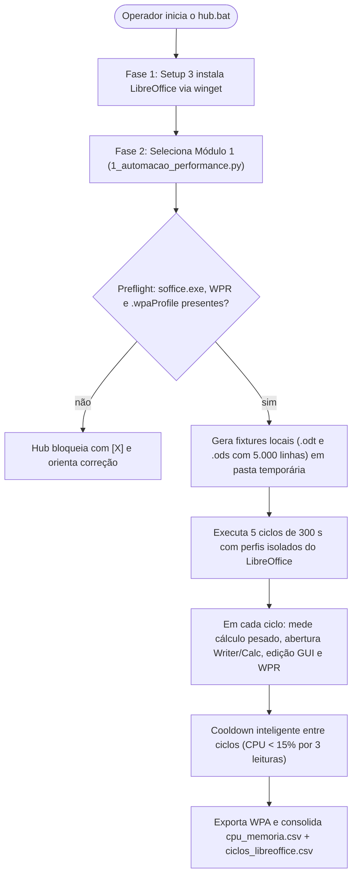

# 001 — Módulo 1 com workloads locais no LibreOffice

> **Em uma frase:** Substitui o workload web (Google Docs/Sheets no Edge) do Módulo 1 por automação 100% local e offline no LibreOffice (Writer e Calc), eliminando a necessidade de login no Google e medindo tempo de abertura dos aplicativos, tempo de cálculo de fórmulas complexas e consumo de CPU e RAM sob captura WPR/WPA.
>
> **Ideias de origem:** IDEIAS #1 · **Domínio:** testes / 1_cpu_memo · **Status:** em execução

## 🎯 Problema e resultado

| Hoje | Quando estiver pronto |
|---|---|
| O Módulo 1 (`1_automacao_performance.py`) abre Google Docs, Google Sheets e um PDF online no Microsoft Edge, exigindo conta Google autenticada, conexão com a internet e intervenção manual do analista quando a sessão expira. | O Módulo 1 roda 100% automático e offline usando o LibreOffice instalado pelo Setup, sem login e sem internet. |
| O teste mede apenas o perfil WPR/WPA e uma foto final de frequência/RAM após o término dos ciclos, sem cronometrar o tempo de abertura dos apps de escritório, o consumo contínuo de CPU/RAM nem o impacto dos agentes de segurança em cálculos pesados de planilha. | Cada um dos 5 ciclos cronometra o tempo de abertura do Writer e do Calc, o tempo de recálculo e exportação de uma planilha `.ods` com 5.000 linhas e fórmulas complexas, e amostra continuamente CPU e RAM do sistema e dos processos do LibreOffice em conjunto com a captura WPR/WPA. |

## 👤 Fluxo de uso

1. Na Fase 1 (Preparação), o script `Setup/environment/3_softwares_msStore.ps1` garante a instalação silenciosa do `TheDocumentFoundation.LibreOffice` via `winget`.
2. Na Fase 2 (Testes), ao selecionar `1_automacao_performance.py`, a checagem antes da fila (`Get-PreflightFindings` no `hub.ps1`) valida a presença do LibreOffice via sonda `Test-LibreOfficeAvailable` (além de `wpr.exe`, `wpaexporter.exe` e `Agentes_SI_Profile.wpaProfile`).
3. Antes do Ciclo 1, o script gera localmente os arquivos de carga determinísticos (`workload_doc.odt` e `workload_calc_complexo.ods` com 5.000 linhas de dados e 5 colunas de fórmulas OpenFormula) em uma pasta de trabalho temporária.
4. Para cada um dos 5 ciclos (300 s de carga ativa + cooldown inteligente até 300 s):
   - Estabiliza por 15 s (`STABILIZE_SECONDS`), inicia a captura WPR (`Power.light` + `VirtualAllocation.light`) e inicia a thread amostradadora `psutil` (intervalo de 1,0 s medindo CPU % e RAM MB/% do sistema e da árvore de processos `soffice.exe`/`soffice.bin`).
   - **Etapa 1 — Cálculo de fórmulas complexas (`Tempo_Calculo_Formulas_s`):** Executa `soffice.exe` em modo batch (`--headless --convert-to pdf`) com subperfil isolado `wintesthub_lo_profile_batch` sobre uma cópia fresca de `workload_calc_complexo.ods`, cronometrando o tempo até o término do processo e a gravação do PDF recalculado (> 0 bytes).
   - **Etapa 2 — Abertura do Writer (`Tempo_Abertura_Writer_s`):** Inicia `soffice.exe --writer` com subperfil isolado `wintesthub_lo_profile_writer` abrindo uma cópia do `workload_doc.odt`, cronometrando até o processo `soffice.bin` do perfil estar ativo e sua janela principal visível na área de trabalho.
   - **Etapa 3 — Abertura do Calc (`Tempo_Abertura_Calc_s`):** Inicia `soffice.exe --calc` com subperfil isolado `wintesthub_lo_profile_calc` abrindo uma cópia de `workload_calc_complexo.ods`, cronometrando até o processo `soffice.bin` desse subperfil estar ativo e sua janela principal visível.
   - **Etapa 4 — Edição GUI contínua no restante da janela de 300 s:** Alterna o foco entre as janelas do Writer e do Calc, simulando digitação de parágrafos (`pyperclip` + `Ctrl+V`), formatação (`Ctrl+A`, `Ctrl+B`) e salvamento (`Ctrl+S`) no Writer, e navegação de células, inserção de linhas de dados, recálculo forçado (`Ctrl+Shift+F9`) e salvamento (`Ctrl+S`) no Calc.
   - Ao completar os 300 s do ciclo, encerra os processos do LibreOffice do teste, para a amostragem `psutil` do ciclo, salva o `.etl` do WPR, executa o `wpaexporter.exe` e roda o cooldown inteligente (3 leituras consecutivas de CPU < 15% a cada 10 s, teto de 300 s).
5. Ao concluir os 5 ciclos, consolida os CSVs do WPA em `Resultados_Consolidados/` e grava `cpu_memoria.csv` e `ciclos_libreoffice.csv` em `HUB_EVIDENCE_DIR`.

## ✅ Critérios de aceite

- [ ] `Setup/environment/3_softwares_msStore.ps1` inclui `"TheDocumentFoundation.LibreOffice"` no array `$apps` instalado via `winget`.
- [ ] `hub.ps1` define a função de sonda `Test-LibreOfficeAvailable` (verificando `HUB_LIBREOFFICE_PATH`, `Test-CommandAvailable -Cmd "soffice"`, `C:\Program Files\LibreOffice\program\soffice.exe` e `C:\Program Files (x86)\LibreOffice\program\soffice.exe`), e `Get-PreflightFindings` emite achado `Impede` exclusivamente para `1_automacao_performance.py` quando `Test-LibreOfficeAvailable` retorna `$false`, com ação orientando rodar o Setup `3_softwares_msStore`.
- [ ] `Get-TestLeftovers` e `Stop-TestLeftovers` em `hub.ps1` detectam processos `soffice.exe` e `soffice.bin` cuja linha de comando contenha `wintesthub_lo_profile` (Id `libreoffice`, Nome `LibreOffice da automacao`, associado a `@("1_cpu_memo")`), e removem `1_cpu_memo` da lista de pastas da sobra `edge`.
- [ ] `Testes/1_cpu_memo/1_automacao_performance.py` não importa nem utiliza `selenium` ou `msedge`, e executa 100% offline sem pedir login.
- [ ] A função geradora de fixtures em `1_automacao_performance.py` cria arquivos `.odt` e `.ods` válidos usando apenas a biblioteca padrão (`zipfile` + XML), onde a planilha `.ods` possui 1 linha de cabeçalho e 5.000 linhas de dados determinísticos (`random.Random(42)`) com 5 colunas de dados base (`A` a `E`) e 5 colunas de fórmulas OpenFormula (`F` a `J`: `SUM`, `IF`, `VLOOKUP`, `COUNTIF` e `AVERAGE`).
- [ ] Em cada ciclo, o script mede e registra todas as colunas definidas para `ciclos_libreoffice.csv`: tempo de abertura do Writer (s), tempo de abertura do Calc (s), tempo de cálculo/exportação da planilha complexa (s), contadores de edição GUI, CPU média/pico do sistema (%), RAM média/pico do sistema (MB e %), CPU média/pico do LibreOffice (%) e RAM média/pico do LibreOffice (MB), além da duração do cooldown (s).
- [ ] A captura WPR (`Power.light` e `VirtualAllocation.light`), a exportação via `wpaexporter.exe` com `Agentes_SI_Profile.wpaProfile`, a parada segura com `Ctrl+Q` (`HUB_STOP_FILE`), o overlay click-through Tkinter e o cooldown inteligente mantêm o contrato de exit code (`0` = PASS somente se os 5 ciclos completarem sem erro; `1` = FAIL).
- [ ] O arquivo `cpu_memoria.csv` mantém todas as métricas legadas (`Ciclos_Executados`, `Duracao_Por_Ciclo`, `CPU_Frequencia_Atual`, `CPU_Frequencia_Max`, `CPU_Nucleos_Fisicos`, `CPU_Nucleos_Logicos`, `RAM_Total_GB`, `RAM_Disponivel_GB`, `RAM_Uso_Percentual`, `WPA_*`) e acrescenta todas as novas métricas especificadas na seção de contratos, incluindo `WPA_<Arquivo>_<Metrica>_Soma_Media`.
- [ ] O arquivo `ciclos_libreoffice.csv` é gerado em `HUB_EVIDENCE_DIR` com 5 linhas (ciclos `1` a `5`) e cabeçalho idêntico ao contrato.
- [ ] `.github/scripts/Test-Preflight.ps1` e um novo teste Python `.github/scripts/test_cpu_memo_libreoffice.py` (executado em `.github/workflows/ci.yml`) validam as novas regras e contratos no CI.
- [ ] `README.md`, `docs/metodologia-de-testes.md` e `docs/manual-de-execucao.md` são atualizados refletindo o LibreOffice no Módulo 1, e `python docs/gerar_html.py --check` passa sem divergências.

## 🧭 Fronteira

| Dentro | Fora (e por quê) |
|---|---|
| `Testes/1_cpu_memo/1_automacao_performance.py`: substituição completa do Edge/Selenium/Google pelo LibreOffice Writer e Calc com geração local de `.odt` e `.ods` complexo. | `Testes/1_cpu_memo/1-1_automacao_performance_dlp.py`: permanece inalterado; já é 100% automático e offline (cópia de `.xlsx` de 100 MB para pendrive USB). |
| `Setup/environment/3_softwares_msStore.ps1`: adição do pacote `TheDocumentFoundation.LibreOffice` via `winget`. | `Testes/5_bateria/5_teste_bateria.py`: a fase de escritório do teste de bateria permanece no Edge (contrato da spec 003). |
| `hub.ps1`, `.github/scripts/Test-Preflight.ps1`, `.github/scripts/test_cpu_memo_libreoffice.py` e `.github/workflows/ci.yml`: checagem pré-fila do `soffice.exe` para `1_automacao_performance.py`, limpeza de sobras do LibreOffice do teste e testes automatizados no CI. | Reprovação automática por limite de tempo (`referencia.json` / teto 10x): o teste aprova pela conclusão íntegra dos 5 ciclos; a comparação de performance entre `ImagemLimpa` e `ComAgentes` é analítica via CSV/relatório. |
| Documentação (`README.md`, `docs/metodologia-de-testes.md`, `docs/manual-de-execucao.md` e HTMLs gerados). | Remoção do `selenium` de `5_install_py_dependencies.ps1`: os módulos 3 e 5 ainda utilizam Selenium + Edge. |

## 🔌 Contratos de dado e interface

### 1. Localização do executável do LibreOffice

Ordem de resolução do binário `soffice.exe` (em `1_automacao_performance.py` e na sonda `Test-LibreOfficeAvailable` do `hub.ps1`):
1. Variável de ambiente `HUB_LIBREOFFICE_PATH` (se definida e o caminho existir).
2. `shutil.which("soffice.exe")` / `shutil.which("soffice")` (no PowerShell: `Test-CommandAvailable -Cmd "soffice"`).
3. Caminhos padrão do Windows:
   - `C:\Program Files\LibreOffice\program\soffice.exe`
   - `C:\Program Files (x86)\LibreOffice\program\soffice.exe`

### 2. Isolamento de perfil e flags de execução

Todas as invocações do LibreOffice pelo teste devem passar:
- `-env:UserInstallation=file:///<caminho_temp_com_barras_normais>/wintesthub_lo_profile_<papel>` onde `<papel>` é `batch` (cálculo headless), `writer` (janela GUI do Writer) ou `calc` (janela GUI do Calc). Usar 3 subpastas sob o prefixo `wintesthub_lo_profile_` impede que a instância GUI do Writer absorva o processo do Calc (garantindo processos `soffice.bin` separados e *cold start* real para cada app) e permite detectar qualquer instância do teste pelo substring `wintesthub_lo_profile`.
- Flags obrigatórias: `--norestore`, `--nologo`, `--nodefault`, `--nolockcheck`.

### 3. Estrutura exata da planilha `.ods` de benchmark (`workload_calc_complexo.ods`)

Gerada via `zipfile.ZipFile` com entradas `mimetype` (`application/vnd.oasis.opendocument.spreadsheet`, `ZIP_STORED` sem compressão, primeira entrada do ZIP), `META-INF/manifest.xml` e `content.xml` (`ZIP_DEFLATED`).
- Semente determinística: `rng = random.Random(42)`.
- Total de linhas na tabela `Planilha1`: **5.001 linhas** (linha `1` = cabeçalho; linhas `2` a `5001` = 5.000 registros).
- Colunas por linha `r` (`2 <= r <= 5001`):
  - **Coluna A (`Departamento`, string):** escolhida ciclicamente entre `("Vendas", "Marketing", "TI", "RH", "Operacoes", "Financeiro", "Logistica", "Juridico", "Suporte", "Engenharia")`.
  - **Coluna B (`Receita`, float):** `round(rng.uniform(1000.0, 100000.0), 2)`.
  - **Coluna C (`Despesa`, float):** `round(rng.uniform(500.0, 95000.0), 2)`.
  - **Coluna D (`Imposto_Taxa`, float):** `round(rng.uniform(0.05, 0.27), 4)`.
  - **Coluna E (`Indice_Lookup`, float):** chave numérica `float(r - 1)` (`1.0` a `5000.0`).
  - **Coluna F (`Saldo_Liquido`, fórmula OpenFormula):** `of:=[.B{r}]-[.C{r}]-([.B{r}]*[.D{r}])`
  - **Coluna G (`Status_Margem`, fórmula OpenFormula):** `of:=IF([.F{r}]>0;([.F{r}]/[.B{r}])*100;-100)`
  - **Coluna H (`Media_Movel_50`, fórmula OpenFormula):** `of:=AVERAGE([.B{max(2, r-49)}:.B{r}])`
  - **Coluna I (`Busca_Cruzada`, fórmula OpenFormula):** `of:=VLOOKUP([.E{r}];[.E$2:.F$5001];2;0)` (onde o índice buscado é deslocado: `target_idx = ((r - 2 + 2500) % 5000) + 1`, ou seja, `of:=VLOOKUP({target_idx};[.E$2:.F$5001];2;0)` para forçar varredura na tabela de 5.000 linhas).
  - **Coluna J (`Contagem_Acima`, fórmula OpenFormula):** `of:=COUNTIF([.B$2:.B$5001];">50000")` nas linhas múltiplas de 10 (`r % 10 == 0`) e `of:=SUM([.B{max(2, r-20)}:.C{r}])` nas demais linhas (evitando complexidade quadrática que exceda 60 s, mantendo ~500 varreduras globais + 5.000 `VLOOKUP` + 15.000 fórmulas aritméticas/condicionais).
- As células de fórmula (`F` a `J`) são gravadas no `content.xml` com `table:formula="of:=..."` e `office:value-type="float"` com `office:value="0"`, obrigando o LibreOffice Calc a calcular os valores reais ao carregar e exportar a planilha.

### 4. Contrato do CSV temático `cpu_memoria.csv`

Local: `<HUB_EVIDENCE_DIR>/cpu_memoria.csv` (UTF-8, separador `,`, cabeçalho `Metrica,Valor,Unidade`).

| Métrica | Tipo | Unidade | Descrição |
|---|---|---|---|
| `Versao_Teste` | string | `` | Fixo `2.0` |
| `Ciclos_Executados` | int | `un` | Número de ciclos concluídos (`5`) |
| `Duracao_Por_Ciclo` | int | `s` | Duração da janela de carga por ciclo (`300`) |
| `Tempo_Abertura_Writer_Media` | float (`.2f`) | `s` | Média dos 5 ciclos para abertura do Writer com documento `.odt` |
| `Tempo_Abertura_Writer_Max` | float (`.2f`) | `s` | Maior tempo de abertura do Writer entre os 5 ciclos |
| `Tempo_Abertura_Calc_Media` | float (`.2f`) | `s` | Média dos 5 ciclos para abertura do Calc com planilha `.ods` |
| `Tempo_Abertura_Calc_Max` | float (`.2f`) | `s` | Maior tempo de abertura do Calc entre os 5 ciclos |
| `Tempo_Calculo_Formulas_Media` | float (`.2f`) | `s` | Média dos 5 ciclos para abertura, recálculo completo e exportação PDF da planilha complexa |
| `Tempo_Calculo_Formulas_Max` | float (`.2f`) | `s` | Maior tempo de cálculo da planilha complexa entre os 5 ciclos |
| `Tempo_Calculo_Formulas_Min` | float (`.2f`) | `s` | Menor tempo de cálculo da planilha complexa entre os 5 ciclos |
| `CPU_Sistema_Media` | float (`.1f`) | `%` | Uso médio de CPU total da máquina durante os 5 ciclos de carga |
| `CPU_Sistema_Pico` | float (`.1f`) | `%` | Pico de CPU total da máquina durante os 5 ciclos de carga |
| `RAM_Sistema_Media_MB` | float (`.1f`) | `MB` | Uso médio de RAM do sistema (`used`) durante os 5 ciclos de carga |
| `RAM_Sistema_Pico_MB` | float (`.1f`) | `MB` | Pico de RAM do sistema (`used`) durante os 5 ciclos de carga |
| `RAM_Sistema_Media_Pct` | float (`.1f`) | `%` | Percentual médio de RAM do sistema durante os 5 ciclos de carga |
| `RAM_Sistema_Pico_Pct` | float (`.1f`) | `%` | Percentual de pico de RAM do sistema durante os 5 ciclos de carga |
| `LibreOffice_CPU_Media` | float (`.1f`) | `%` | Soma média de CPU dos processos `soffice.exe`/`soffice.bin` (normalizada por núcleos lógicos) |
| `LibreOffice_CPU_Pico` | float (`.1f`) | `%` | Pico de CPU dos processos `soffice.exe`/`soffice.bin` |
| `LibreOffice_RAM_Media_MB` | float (`.1f`) | `MB` | Soma média de RSS (`memory_info().rss`) dos processos `soffice.exe`/`soffice.bin` |
| `LibreOffice_RAM_Pico_MB` | float (`.1f`) | `MB` | Pico de RSS dos processos `soffice.exe`/`soffice.bin` |
| `CPU_Frequencia_Atual` | float (`.0f`) / `N/A` | `MHz` | Legado mantido |
| `CPU_Frequencia_Max` | float (`.0f`) / `N/A` | `MHz` | Legado mantido |
| `CPU_Nucleos_Fisicos` | int | `un` | Legado mantido |
| `CPU_Nucleos_Logicos` | int | `un` | Legado mantido |
| `RAM_Total_GB` | float (`.2f`) | `GB` | Legado mantido |
| `RAM_Disponivel_GB` | float (`.2f`) | `GB` | Legado mantido |
| `RAM_Uso_Percentual` | float (`.1f`) | `%` | Legado mantido |
| `WPA_<Arquivo>_<Metrica>_Soma_Media` | float (`.2f`) | `` | Soma de todos os processos do `.wpaProfile` na métrica (média entre os ciclos) |
| `WPA_<Arquivo>_<Metrica>_Media` | float (`.2f`) | `` | Média por processo do `.wpaProfile` (legado mantido) |
| `WPA_<Arquivo>_<Metrica>_Max` | float (`.2f`) | `` | Máximo por processo do `.wpaProfile` (legado mantido) |
| `WPA_<Arquivo>_<Metrica>_Min` | float (`.2f`) | `` | Mínimo por processo do `.wpaProfile` (legado mantido) |

### 5. Contrato do CSV detalhado por ciclo `ciclos_libreoffice.csv`

Local: `<HUB_EVIDENCE_DIR>/ciclos_libreoffice.csv` (UTF-8, separador `,`).

Colunas obrigatórias (nesta ordem):
`Ciclo,Timestamp_Inicio,Tempo_Abertura_Writer_s,Tempo_Abertura_Calc_s,Tempo_Calculo_Formulas_s,Linhas_Editadas_Calc,Paragrafos_Digitados_Writer,CPU_Sistema_Media_Pct,CPU_Sistema_Pico_Pct,RAM_Sistema_Media_MB,RAM_Sistema_Pico_MB,RAM_Sistema_Media_Pct,RAM_Sistema_Pico_Pct,LibreOffice_CPU_Media_Pct,LibreOffice_CPU_Pico_Pct,LibreOffice_RAM_Media_MB,LibreOffice_RAM_Pico_MB,Cooldown_Duracao_s`

## ⚠️ Casos de borda

| Situação | Comportamento esperado |
|---|---|
| `soffice.exe` ausente na máquina | Na checagem pré-fila do `hub.ps1`, aparece como `[X] Impede` apenas para `1_automacao_performance.py` (não bloqueia `1-1_automacao_performance_dlp.py`). Na execução avulsa, o script falha no `check_prerequisites()` com exit code `1` e mensagem clara no log. |
| Primeiro uso do LibreOffice ou diálogo de recuperação de documento após crash anterior | O uso de `-env:UserInstallation` em subpastas temporárias limpas a cada ciclo (`wintesthub_lo_profile_*`) + `--norestore` `--nologo` `--nodefault` `--nolockcheck` elimina o wizard inicial e o diálogo de recuperação de arquivos. |
| Processo do LibreOffice trava durante o recálculo de fórmulas complexas ou abertura de janela | A etapa de recálculo em lote tem timeout de 180 s e a abertura de janela tem timeout de 60 s; se estourar, encerra a árvore de processos do LibreOffice do teste, cancela o WPR e encerra o teste com FAIL (`exit code 1`). |
| `Agentes_SI_Profile.wpaProfile` ausente na pasta `Testes/1_cpu_memo/` | Em execução avulsa, o teste registra aviso no log, grava os `.etl` e gera `cpu_memoria.csv` e `ciclos_libreoffice.csv` normalmente com as métricas de tempo e `psutil` (deixando o módulo não-vazio na pasta `Exportar/`). No hub, o preflight continua apontando o `.wpaProfile` ausente antes da fila. |
| Operador pressiona `Ctrl+Q` ou aciona o FailSafe do PyAutoGUI | Cancela imediatamente a sessão WPR ativa, encerra apenas os processos `soffice.exe`/`soffice.bin` com `wintesthub_lo_profile` na linha de comando, remove as pastas temporárias do perfil, grava `HUB_STOP_FILE` e sai com código `1` (FAIL). |

## 🧱 Stack e convenções do workspace

- **Runtime:** Python 3.12 (`.venv` criado por `Setup/environment/5_install_py_dependencies.ps1`) e Windows PowerShell 5.1 (`hub.ps1`, `Setup/`).
- **Bibliotecas Python já instaladas no `.venv`:** `psutil`, `pyautogui`, `pyperclip`, `pandas`, `pynput`, `tkinter` (stdlib), `zipfile` e `xml.etree.ElementTree` (stdlib). Nenhuma dependência Python nova é necessária.
- **Convenção de saída e logs:** logs e `print` no console sem caracteres fora da página `cp1252` (com `sys.stdout.reconfigure(errors="replace")`); exit code definido na thread principal (`sys.exit(_exit_code)`).
- **Testes de CI (`.github/workflows/ci.yml`):**
  - Sintaxe Python (`ruff check --select E9,F63,F7,F82`, `python -m compileall -q Testes/ docs/`) e PowerShell (parser PS 5.1 + `PSScriptAnalyzer -Severity Error`).
  - `.github/scripts/Test-Preflight.ps1` (testa `Get-PreflightFindings` e `Get-TestLeftovers` com sondas substituídas).
  - `.github/scripts/Test-ThematicCSVs.ps1` (valida `cpu_memoria.csv`).
  - `python docs/gerar_html.py --check` (valida sincronia entre `docs/*.md` e `docs/*.html`).

## 📦 Soluções open source avaliadas

| Projeto | O que resolve | Licença | Última release | Adoção | Veredito |
|---|---|---|---|---|---|
| [`psutil`](https://github.com/giampaolo/psutil) + [`pyautogui`](https://github.com/asweigart/pyautogui) + stdlib `zipfile`/XML | Geração de arquivos ODF (`.odt`/`.ods`), automação da GUI real do LibreOffice e amostragem de CPU/RAM por processo | BSD-3-Clause / BSD | `7.2.2` / `0.9.54` | ~300M+ e ~2.5M downloads/mês (já no projeto) | **adotar** (já em uso) |
| [`ooo-dev-tools`](https://github.com/Amourspirit/python_ooo_dev_tools) (`pyuno`) | Wrapper orientado a objetos sobre a bridge Python-UNO do LibreOffice | Apache-2.0 | `0.53.4` (mai/2025) | ~51 stars | **descartar** (exige acoplar o Python interno do LibreOffice ao `.venv` no Windows e opera via socket sem exercitar a GUI completa) |
| [`pywinauto`](https://github.com/pywinauto/pywinauto) | Automação de janelas nativas Win32/UIA no Windows | BSD-3-Clause | `0.6.9` (jan/2025) | ~6.5k stars | **descartar** (adicionaria dependência nativa pesada quando `pyautogui` + linha de comando do `soffice.exe` já atendem) |
| [`odfpy`](https://pypi.org/project/odfpy/) | Criação e leitura programática de arquivos `.odt` e `.ods` | Apache-2.0 / GPL / LGPL | `1.4.1` | ~5.1M downloads/mês | **inspirar** (um `.ods`/`.odt` mínimo é apenas um ZIP com `mimetype` e `content.xml`; gerar direto com `zipfile` da stdlib evita nova dependência e dual-license GPL) |

**Decisão:** Construir sobre a stack já instalada no projeto (`psutil`, `pyautogui`, `pyperclip`, `pandas` e `zipfile`/XML da stdlib) + CLI do LibreOffice (`soffice.exe`) — zero dependência Python nova e fidelidade total ao uso real de desktop monitorado por agentes de segurança.

## 🧾 Decisões

| Decisão | Alternativas rejeitadas | Porquê | Custo de reverter |
|---|---|---|---|
| Gerar `.odt` e `.ods` complexo via `zipfile` + `content.xml` nativo do Python | Adicionar `odfpy` ao `5_install_py_dependencies.ps1` ou versionar binários `.ods` grandes no Git | Um arquivo ODF válido precisa apenas de `mimetype`, `META-INF/manifest.xml` e `content.xml` no ZIP; gera planilhas de 5.000 linhas com fórmulas em < 1 s sem pesar o repositório nem adicionar pacote ao setup | Baixo (isolado na função geradora de fixtures do script) |
| Medir a abertura dos apps pela detecção do processo `soffice.bin` + janela Win32 visível e o cálculo pesado via execução dedicada `soffice.exe --headless --convert-to pdf` da planilha `.ods` | Medir cálculo apenas por `pyautogui` olhando a barra de status na tela | A conversão da planilha `.ods` gerada com células de fórmula não-cacheadas obriga o motor do Calc (`soffice.bin`) a abrir, avaliar todas as fórmulas e gravar o PDF, fornecendo um tempo determinístico ao milissegundo, enquanto a etapa seguinte exercita a GUI interativa | Baixo (ambas as etapas rodam dentro do mesmo ciclo) |
| Usar `-env:UserInstallation` em subpastas temporárias por papel (`wintesthub_lo_profile_batch`, `wintesthub_lo_profile_writer`, `wintesthub_lo_profile_calc`) | Usar o perfil padrão do usuário ou um único perfil compartilhado entre Writer e Calc | Se Writer e Calc compartilharem o mesmo `UserInstallation` simultaneamente, o segundo `soffice.exe` delega ao primeiro `soffice.bin` e fecha imediatamente; subperfis separados garantem *cold start* real e janelas/PIDs independentes, todos identificáveis pelo prefixo `wintesthub_lo_profile` | Baixo (parâmetro de linha de comando) |
| Criar a sonda `Test-LibreOfficeAvailable` no `hub.ps1` e checar apenas para `1_automacao_performance.py` | Checar `Test-Path` inline dentro de `Get-PreflightFindings` ou para toda a pasta `1_cpu_memo` | `Test-Preflight.ps1` substitui as funções de sonda para rodar de forma determinística no CI, e a variante `1-1_automacao_performance_dlp.py` não usa LibreOffice | Baixo (1 função de sonda em `hub.ps1`) |
| Calcular também `WPA_<Arquivo>_<Metrica>_Soma_Media` na consolidação do WPA | Manter apenas a média das linhas exportadas pelo WPA | O `.wpaProfile` filtra os processos dos agentes de segurança; somar as linhas mostra o consumo total combinado dos agentes, complementando a média por processo | Baixo (1 linha adicional por métrica WPA no `cpu_memoria.csv`) |

## ❓ Em aberto

Não se aplica — todos os pontos foram fechados na descoberta.

## 🔬 Evidência de validação

- Execução de `.github/scripts/Test-Preflight.ps1` e `.github/scripts/Test-ThematicCSVs.ps1` passando com novos casos de teste cobrindo `Test-LibreOfficeAvailable` (`$false`/`$true`), filtro exclusivo de `1_automacao_performance.py` (sem bloquear `1-1_automacao_performance_dlp.py`) e sobras do LibreOffice (`wintesthub_lo_profile`).
- Execução de `.github/scripts/test_cpu_memo_libreoffice.py` (registrado no job `python` do `.github/workflows/ci.yml`) validando:
  1. Geração determinística dos arquivos `.odt` e `.ods` (ZIP ODF válido com `mimetype` como primeira entrada não comprimida, 5.001 linhas no `content.xml` e fórmulas OpenFormula `of:=` com `SUM`, `IF`, `AVERAGE`, `VLOOKUP`, `COUNTIF`).
  2. Consolidação de métricas e geração de `cpu_memoria.csv` e `ciclos_libreoffice.csv` com todas as colunas exigidas no contrato (com e sem CSVs do WPA).
- Execução de `ruff check --select E9,F63,F7,F82 Testes/ docs/`, `python -m compileall -q Testes/ docs/` e `python docs/gerar_html.py --check` sem erros.

## 🔗 Dependências e handoff

- **Depende de:** nenhuma outra spec pendente.
- **Condição para começar:** pronta para execução imediata.
- **Fronteiras de arquivo sugeridas para execução:** veja `plan.md`.
