# Plano Técnico — 005: Módulo 5 (Bateria v2.0 — LibreOffice + Tempo Real)

## 1. Arquitetura e visão geral do delta

O Módulo 5 deixa de depender de Edge/Google Docs/Sheets e passa a consumir um novo módulo compartilhado `Testes/_lib/libreoffice_workload.py` (extraído das rotinas já validadas no Módulo 1, mantendo `1_automacao_performance.py` intocado). O ciclo de vida da medição evolui para **estabilização (5 min) → fase ociosa fixa (60 min + WPR) → fase ativa contínua no LibreOffice até 10% de bateria (WPR apenas na 1ª hora)**, com **encerramento rápido em ~15 s** (grava `bateria.csv` + `batteryreport depois` + restaura tudo) antes de aguardar a reconexão do carregador para a pós-medição pesada (`wpaexporter`, `srumutil`, `powercfg /energy`).

```mermaid
flowchart LR
    subgraph Lib["Testes/_lib/libreoffice_workload.py (novo)"]
        DISC["find_libreoffice_executable<br/>build_user_installation_uri<br/>seed_lo_profile"]
        FIX["generate_odt_fixture<br/>generate_r2_xlsx<br/>generate_odf_fixtures"]
        PROC["launch_app · wait_lo_idle<br/>focus_window · verify_focus<br/>kill_test_libreoffice"]
    end
    subgraph Mod5["Testes/5_bateria/5_teste_bateria.py (v2.0)"]
        PRE["Pré-voo (soffice, rede c/ internet,<br/>carga >=95%, modo Equilibrado)"]
        IDLE["Fase Ociosa (60 min + WPR)"]
        ACT["Fase Ativa LibreOffice até 10%<br/>(WPR 1h → sem WPR até 10%)"]
        CHK["Checkpoint contínuo +<br/>Detector de hibernação"]
        FAST["Encerramento rápido (~15s)<br/>bateria.csv + restaurar_tudo()"]
        HEAVY["Diálogo reconexão →<br/>wpaexporter · SRUM · /energy"]
    end
    subgraph Hub["hub.ps1"]
        HPF["Preflight: LibreOffice p/ 5_bateria"]
        HLO["Leftovers: libreoffice/wpr/wpaexporter<br/>(remove edge de 5_bateria)"]
    end
    Lib --> Mod5
    PRE --> IDLE --> ACT --> FAST --> HEAVY
    CHK -.-> IDLE
    CHK -.-> ACT
    Hub --> Mod5
```

## 2. Camadas afetadas

### 2.1. Módulo compartilhado (`Testes/_lib/libreoffice_workload.py`)

Projetado para ser importável em qualquer ambiente (inclusive Linux no CI) com imports defensivos de `psutil`, `pyautogui` e `pyperclip`:

1. **Constantes e descoberta:**
   - `LO_PROFILE_PREFIX = "wintesthub_lo_profile"` (mantém compatibilidade direta com `Get-TestLeftovers` no `hub.ps1`).
   - `LO_COMMON_FLAGS = ["--norestore", "--nologo", "--nodefault", "--nolockcheck"]`.
   - `DEFAULT_LO_PATHS = (r"C:\Program Files\LibreOffice\program\soffice.exe", r"C:\Program Files (x86)\LibreOffice\program\soffice.exe")`.
   - `find_libreoffice_executable(env=None, which_fn=shutil.which, exists_fn=os.path.exists)`.
   - `build_user_installation_uri(profile_dir)` e `seed_lo_profile(profile_dir)` (`OOXMLRecalcMode=0`, `WarnAlienFormat=false`).
2. **Geradores determinísticos de fixtures:**
   - `TYPING_SAMPLES` (8 frases), `R2_ROWS = 5000`, `R2_FORMULA_COLS = 20`, `R2_XLSX_NAME = "workload_calc_r2.xlsx"`, `R2_ZIP_DATE = (1980, 1, 1, 0, 0, 0)`.
   - `generate_odt_fixture(target_path, title="Documento de Benchmark — WinTestHub")`.
   - `generate_r2_xlsx(target_path)` (idêntica à R2 do Módulo 1: 4 abas `Data`, `Calc`, `Trigger` ativa, `Sentinel`; 100k fórmulas sem `<v>` em cache).
   - `generate_odf_fixtures(work_dir)` → `(odt_path, xlsx_path)`.
3. **Controle de processos e janelas Win32 (parametrizado com `check_stop_fn` e `sleep_fn`):**
   - `is_test_libreoffice_proc(name, cmdline_list, profile_marker=LO_PROFILE_PREFIX)`.
   - `lo_tree_procs(roots, known)` e `kill_test_libreoffice(roots=None, profile_marker=LO_PROFILE_PREFIX, log=None)`.
   - `find_visible_window_for_pids(target_pids)`, `launch_app(soffice_path, mode, file_path, profile_uri, roots, timeout=60, check_stop_fn=None, sleep_fn=time.sleep, log=None)` → `(elapsed_s, pid, hwnd)`.
   - `wait_lo_idle(hwnd, timeout=60, idle_cpu_pct=5.0, idle_samples=2, idle_interval=0.5, check_stop_fn=None, sleep_fn=time.sleep, user32=None, log=None)`.
   - `verify_window_focused(hwnd, user32=None)` e `focus_window(hwnd, sleep_fn=time.sleep, log=None)`.
   - `is_window_alive(hwnd, user32=None)` (helper para o Módulo 5 detectar se Writer/Calc fechou inesperadamente em rodadas de 6–12 h e relançar).

### 2.2. Refatoração do Módulo 5 (`Testes/5_bateria/5_teste_bateria.py`)

1. **Constantes e configuração (`v2.0`):**
   - `VERSAO_TESTE = "2.0"`.
   - `PROTECAO_BATERIA_PCT = 10` (substitui `7`).
   - `DURACAO_WPR_ESCRITORIO_S = 60 * 60` (substitui `DURACAO_ESCRITORIO_S` como teto da fase — a fase ativa não tem mais duração fixa).
   - `MODO_ENERGIA_ALVO = MODO_EQUILIBRADO` (substitui `MODO_MELHOR_DESEMPENHO` em `ajustar_modo_dc`, `conferir_na_bateria`, `coletar_amostra` e mensagens).
   - `INTERVALO_RECALC_CALC_S = 5 * 60`, `WRITER_MAX_PARAGRAFOS = 60`, `LIMIAR_SALTO_HIBERNACAO_S = 120`.
   - Remover constantes/funções legadas do Edge (`URLS_PRONTIDAO`, `URLS_ESCRITORIO`, `ESCRITORIO_MINIMO_PASS_S`, `ESTABILIZAR_EDGE_S`, `TENTATIVAS_LOGIN`, `EDGE_FLAGS`, `_edge`, `LoginExigido`, `kill_edge`, `abrir_edge`, `_get_current_tab_url`, `_check_edge_welcome_screen`, `_check_google_login_screen`, `_check_extra_tabs`, `_TEXTO_LOGIN`, `_pendencia_edge`, `verificar_prontidao_edge`, `abrir_edge_para_escritorio`, `simulate_document_editing`, `simulate_spreadsheet_editing`, `simulate_pdf_reading`, `TAB_ACTIONS`, `PrazoDaFase`, `_prazo_fase`).
2. **Pré-voo atualizado:**
   - Em `checagens_rapidas(ui)`: adicionar item `"LibreOffice"` conferindo `find_libreoffice_executable()` (falha rápida antes de alterar qualquer ajuste se `soffice.exe` não for encontrado, guardando `_lo_state["soffice_path"]`).
   - Em `executar_preflight(ui)`: manter `conferir_rede()` (com internet) e `conferir_monitor()`; remover chamada `verificar_prontidao_edge(ui)`.
   - Em `ajustar_modo_dc()` e `conferir_na_bateria()`: usar `MODO_ENERGIA_ALVO` (`Equilibrado`) em vez de `MODO_MELHOR_DESEMPENHO`.
   - Em `coletar_amostra()`: checar `modo != MODO_ENERGIA_ALVO` para registrar desvio de padronização.
3. **Sessão LibreOffice e Fase Ativa Contínua:**
   - Estado da sessão `_lo_state`: `soffice_path`, `work_dir`, `roots` (`set()`), `odt_path`, `xlsx_path`, `uri_writer`, `uri_calc`, `hwnd_writer`, `hwnd_calc`, `tempo_abertura_writer_s`, `tempo_abertura_calc_s`, `paragrafos_writer`, `paragrafos_desde_reset`, `linhas_calc`, `recalculos_calc`, `ativo`.
   - `preparar_e_abrir_libreoffice(ui)`:
     - Encerra eventuais sobras do teste (`kill_test_libreoffice`), cria `tempfile.mkdtemp(prefix="wintesthub_lo_bateria_")`, gera fixtures ODT + R2 XLSX, cria subperfis `wintesthub_lo_profile_writer` e `wintesthub_lo_profile_calc` (semeado).
     - Lança Writer (`--writer`, timeout 60 s) e Calc (`--calc`, timeout 180 s + `wait_lo_idle`).
   - `simular_writer()` (usa `pausa()`):
     - Foca Writer, `Ctrl+End`, digita 1 parágrafo via clipboard (`pyperclip` + `Ctrl+V` + `Enter`), formatação ocasional (`Ctrl+B` em 30%), rolagem breve e `Ctrl+S`.
     - Anti-bloat: quando `paragrafos_desde_reset >= WRITER_MAX_PARAGRAFOS`, faz `Ctrl+A`, cola cabeçalho/parágrafo base, `Ctrl+S` e zera `paragrafos_desde_reset`.
   - `simular_calc(forcar_recalculo)` (usa `pausa()`):
     - Foca Calc, garante foco na grade, navega para próxima linha cíclica (`1..25`) da aba `Trigger`, preenche 2 linhas de dados (`_SHEET_DATA_POOL`).
     - Se `forcar_recalculo` for `True` (a cada ≥ `INTERVALO_RECALC_CALC_S` = 5 min): dispara `Ctrl+Shift+F9`, aguarda `wait_lo_idle(hwnd_calc, check_stop_fn=check_stop, sleep_fn=pausa)` e incrementa `recalculos_calc`.
     - Salva com `Ctrl+S`.
   - `recuperar_app_se_fechou(app)`: se `not is_window_alive(hwnd)`, relança apenas Writer ou Calc com novo subperfil/cópia, atualiza `hwnd` e registra `[WARNING]` no log.
   - `executar_fase_escritorio(ui)`:
     - Roda em loop enquanto `not _encerrar.is_set()` e `not _stop_requested.is_set()`.
     - Acompanha `wpr_encerrado = False`: quando `time.monotonic() - inicio >= DURACAO_WPR_ESCRITORIO_S` e `not wpr_encerrado`:
       - Registra amostra-marco `amostra_marco("fim_wpr_escritorio")`.
       - Encerra e salva o trace com `parar_wpr_ativo("Escritorio")`.
       - Marca `wpr_encerrado = True` e atualiza overlay + `[HUB:PROGRESS]` informando que o trace da 1ª hora foi salvo e a descarga real continua sem WPR.
     - Alterna turnos Writer / Calc com pausa realista `pausa(random.uniform(4.0, 10.0))`.
     - Em `pyautogui.FailSafeException`: dispara parada segura (`KeyboardInterrupt`).
     - Em erro pontual de automação: tenta `Escape` + recuperação do app caído, registra warning e continua (não derruba uma descarga de várias horas).
4. **Checkpoint contínuo e detector de hibernação (`MonitorMedicao`):**
   - `gravar_checkpoint(amostra)`: escreve `bateria_checkpoint.json` via `*.tmp` + `os.replace()` contendo `versao`, `fase`, `motivo`, `ultima_amostra`, `marcos` (resumo serializável), `contadores_lo`, `desvios`.
   - Chamado em `coletar_amostra()` e `amostra_marco()`.
   - `detectar_salto_hibernacao(prev_wall, prev_mono, now_wall, now_mono, limiar_s=120)`: função pura que detecta salto anormal (`(now_wall - prev_wall) - (now_mono - prev_mono) > limiar_s` ou `(now_wall - prev_wall) > limiar_s` quando a thread deveria acordar a cada 5 s). Se detectado, chama `registrar_encerramento("hibernacao_inesperada", ...)`.
   - Progresso e overlay na fase ativa (sem duração fixa):
     - Overlay: `"Fase de escritório (descarga real)"`, `"Carga: XX% (alvo 10%) — não use a máquina"`, `"Decorrido: Xh YYmin · WPR: ativo/salvo"`.
     - `[HUB:PROGRESS]`: emitido no máximo 1x/minuto (`atual=None, total=None` na fase ativa, já que não há duração fixa; mantém `minuto/60` na fase ociosa).
5. **Métricas globais, `bateria.csv` e PASS/FAIL:**
   - `calcular_metricas_globais(inicio_ociosa, fim_medicao, carga_cheia_mwh)`: função pura retornando `tempo_total_min`, `tempo_total_h`, `energia_total_mwh`, `taxa_global_w`, `autonomia_equiv_100pct_h`, `estimada`.
   - `calcular_metricas_fase(...)`: mantida e reutilizada também para `escritorio_1h` (`_marcos["escritorio"]["inicio"]` → `_marcos["escritorio"].get("fim_wpr")`).
   - `decidir_exit_code(estado)`: exige `preflight_ok`, `conferencia_ok`, `ociosa_completa`, `escritorio_iniciada`, `escritorio_s > 0`, `motivo == "protecao_bateria"`, `energia_ok`, `bateria_csv`, `amostras_csv`.
   - `linhas_bateria_csv(...)`: gera todas as linhas do contrato v2.0 (seção 2 da `spec.md`).
6. **Reordenação do encerramento e diálogo de reconexão:**
   - `finalizar_medicao_rapido(ui, estaticos)` (roda logo ao sair de `executar_medicao`, ainda em ~10%):
     1. Para WPR ativo (se ainda rodando), para `MonitorMedicao`, coleta `_amostra_final`.
     2. Fecha LibreOffice (`fechar_libreoffice_teste()`) e remove diretório temporário.
     3. `restaurar_na_bateria()`.
     4. `gerar_relatorio_bateria("depois")` (~3–5 s).
     5. `_exit_code = concluir_resultado(ui, estaticos)` (**grava `bateria.csv` agora!**).
     6. `restaurar_tudo()` e `manter_tela_ligada(False)` (**máquina já restaurada!**).
   - `aguardar_reconexao_para_pos_medicao(ui, codigo_resultado)`:
     - Se `status_energia()["fonte"] == "tomada"`, já retorna `"tomada"` sem bloquear.
     - Caso contrário, exibe janela modal com monitoramento automático de `status_energia()["fonte"]` a cada 2 s + botões **"Continuar na bateria"** (`"bateria"`) e **"Pular exportação e finalizar"** (`"pular"`).
     - Se retornar `"tomada"` ou `"bateria"`, executa `pos_medicao_pesada(ui)` (`exportar_traces`, `gerar_srum`, `gerar_relatorio_energia`).
     - Se retornar `"pular"` ou `Ctrl+Q`, pula a exportação pesada preservando os `.etl`, `bateria.csv` e `_exit_code`.

### 2.3. Integração no `hub.ps1`

1. **`Get-PreflightFindings` (`hub.ps1`, linhas ~2330–2336):**
   - Estender o check de `Test-LibreOfficeAvailable` para cobrir tanto `1_automacao_performance.*` em `1_cpu_memo` quanto `5_teste_bateria.*` em `5_bateria` (emitindo achado `Impede` por pasta/teste afetado com ação `"Instale: rode o Setup 3_softwares_msStore"`).
2. **`Get-TestLeftovers` (`hub.ps1`, linhas ~2480–2515):**
   - `wpr`: `@("0_consumo_basal", "1_cpu_memo", "5_bateria")`.
   - `wpaexporter`: `@("0_consumo_basal", "1_cpu_memo", "5_bateria")`.
   - `edge`: `@("3_rede", "6_wifi_fast_transition")` (remove `"5_bateria"`).
   - `libreoffice`: `@("1_cpu_memo", "5_bateria")`.

### 2.4. Testes automatizados e CI

1. **`.github/scripts/test_bateria.py` (novo):**
   - Carrega `Testes/_lib/libreoffice_workload.py` e `Testes/5_bateria/5_teste_bateria.py` com stubs seguros para módulos Windows-only (`winreg`, `ctypes.windll`, `pyautogui`, `pyperclip`, `pynput`, `tkinter`) para rodar tanto em `ubuntu-latest` quanto em `windows-latest`!
   - Verifica:
     - Descoberta, URI, seed e geração determinística ODT + R2 XLSX no `libreoffice_workload.py`.
     - `calcular_metricas_fase` e `calcular_metricas_globais` (com mWh real, com capacidade relativa/estimada por `%`, com 1ª hora completa vs < 60 min).
     - `decidir_exit_code` (todos os caminhos de PASS e FAIL, inclusive bateria desgastada < 30 min na fase ativa).
     - `linhas_bateria_csv` (schema completo v2.0, `Versao_Teste=2.0`, valores e unidades).
     - `gravar_checkpoint` (gravação atômica JSON válido) e `detectar_salto_hibernacao`.
     - Ordem de encerramento no `worker_thread` (garantindo via mocks que `concluir_resultado` e `restaurar_tudo` executam **antes** de `aguardar_reconexao_para_pos_medicao` e `pos_medicao_pesada`).
2. **`.github/scripts/Test-Preflight.ps1`:**
   - Atualizar asserção da linha 264–265 (`5_bateria` detecta `libreoffice`, `wpr` e `wpaexporter`, e não `edge`).
   - Adicionar teste verificando que `5_teste_bateria.py` sem `soffice` gera `Impede` orientando `Setup 3_softwares_msStore`.
3. **`.github/workflows/ci.yml`:**
   - Adicionar execução de `python -I -X utf8 .github/scripts/test_bateria.py` no job `python`.

### 2.5. Documentação

- `README.md`: atualizar pré-requisitos do Módulo 5 (LibreOffice em vez de Edge/conta Google, descarga real até 10%).
- `docs/metodologia-de-testes.md`: atualizar Seção 9 (`Módulo 5 — Bateria`) para v2.0 (LibreOffice, modo Equilibrado, descarga real até 10%, WPR na 1ª hora, novas métricas de tempo real e normalização 100%→0%, novo critério de PASS/FAIL, nota de incompatibilidade com v1.0).
- `docs/manual-de-execucao.md`: atualizar Seção 4.6 (passo a passo do operador sem login Google, tempo variável conforme autonomia real, reconexão do carregador ao atingir 10% para exportação WPA/SRUM).
- Executar `python docs/gerar_html.py` e validar com `python docs/gerar_html.py --check`.

## 3. Fronteiras de arquivo e ordem de execução

| WP | Arquivos exclusivos | Depende de |
|---|---|---|
| **WP-01** — Biblioteca compartilhada LibreOffice | `Testes/_lib/libreoffice_workload.py` | — |
| **WP-02** — Refatoração do Módulo 5 (v2.0) | `Testes/5_bateria/5_teste_bateria.py` | WP-01 |
| **WP-03** — Integração no Hub e regressão PS | `hub.ps1`, `.github/scripts/Test-Preflight.ps1` | — (paralelizável com WP-01/WP-02) |
| **WP-04** — Suíte unitária Python e CI | `.github/scripts/test_bateria.py`, `.github/workflows/ci.yml` | WP-01, WP-02 |
| **WP-05** — Documentação e HTMLs | `README.md`, `docs/metodologia-de-testes.md`, `docs/manual-de-execucao.md`, `docs/*.html` | WP-02, WP-03 |

## 4. Riscos e mitigações

| Risco | Mitigação |
|---|---|
| `5_teste_bateria.py` importar `winreg`/`ctypes.windll`/`powrprof.dll` no top-level e quebrar testes unitários no CI Linux (`ubuntu-latest`) | Proteger `ctypes.WinDLL("powrprof.dll")` e `ctypes.WinDLL("kernel32")` (lazy init ou `if os.name == "nt"`), e tornar imports opcionais (`winreg`, `pyautogui`, `pyperclip`, `pynput`, `tkinter`) seguros para importação em testes unitários. |
| Crescimento do arquivo `.odt` ou vazamento de foco em 8–12 h de automação | Resetar conteúdo do Writer a cada `WRITER_MAX_PARAGRAFOS = 60`; aba `Trigger` do Calc já gira entre linhas 1–25; tentar `Escape` + relançamento automático se Writer/Calc fechar. |
| Perda de dados em bateria desgastada que desliga antes de 10% | `bateria_amostras.csv` com flush a cada 60 s + `bateria_checkpoint.json` atômico + `PROTECAO_BATERIA_PCT = 10%` + detecção de hibernação inesperada. |
| `wpr -stop` na marca de 60 min ativos consumir tempo/energia relevante | Parar WPR de forma assíncrona controlada ou breve pausa marcada no CSV (`fim_wpr_escritorio`) e manter `Trace_Bateria_Escritorio_*.etl` em tamanho limitado a 1 h (~centenas de MB). |
| Notebook desligar durante `wpaexporter` em encerramento autônomo | `bateria.csv`, `batteryreport depois` e `restaurar_tudo()` executam imediatamente em ~15 s; `wpaexporter`/SRUM/`/energy` aguardam reconexão do carregador (com opções manuais de continuar ou pular). |
| Regressão no Módulo 1 recém-validado no lab | `Testes/1_cpu_memo/1_automacao_performance.py` não é modificado nesta spec; `test_cpu_memo_libreoffice.py` roda na verificação final. |
