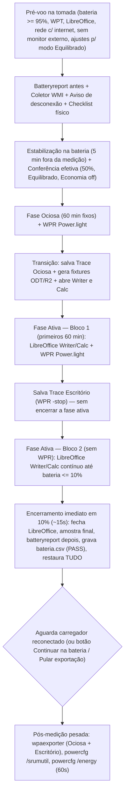

# 005 — Módulo 5 (Bateria v2.0): LibreOffice + Medição de Tempo Real de Bateria

> **Em uma frase:** Migra a fase ativa do Módulo 5 (`Testes/5_bateria/5_teste_bateria.py`) do Microsoft Edge + Google Docs/Sheets para LibreOffice Writer + Calc (planilha R2) via módulo compartilhado `Testes/_lib/libreoffice_workload.py`, e evolui o teste de extrapolação fixa (60+60 min) para medição do **tempo real de bateria** até 10% (60 min ociosa + fase ativa contínua até proteção), padronizado no modo **Equilibrado** e com encerramento seguro antes da exportação WPA/SRUM.
>
> **Domínio:** bateria / workloads-escritorio · **Status:** planejada (`VERSAO_TESTE = "2.0"`)

## 🎯 Problema e resultado

| Hoje (`v1.0`) | Quando estiver pronto (`v2.0`) |
|---|---|
| A fase de escritório do Módulo 5 ainda depende do Microsoft Edge + login manual no Google Docs/Sheets + PDF da Dell, exigindo autenticação antes do teste e falhando se a sessão expirar na bateria (`login_exigido`). | A fase ativa roda 100% local no **LibreOffice Writer + Calc** (planilha R2 de 100.000 fórmulas, reutilizando a carga do Módulo 1), eliminando Edge e login Google. |
| A fase de escritório tem duração fixa de 60 min e o `bateria.csv` reporta apenas **autonomia projetada** por extrapolação linear, sem medir o tempo real de descarga da bateria. | Após os 60 min da fase ociosa (que preservam o comparativo de consumo basal de agentes de SI), a fase ativa roda continuamente até atingir **10% de bateria** (sem teto de tempo), medindo o **tempo real** e calculando também a **autonomia equivalente normalizada para 100%→0%**. |
| O pré-voo força o modo de energia na bateria para **Melhor desempenho**, drenando a bateria mais rápido do que no uso diário real. | O pré-voo padroniza o modo de energia na bateria em **Equilibrado** (`00000000-0000-0000-0000-000000000000`), refletindo a autonomia real do notebook. |
| Ao encerrar em 7%, o script roda `wpaexporter` (pesado em CPU, até 30 min por trace), `srumutil` e `powercfg /energy` **antes** de gravar `bateria.csv` e restaurar as configurações — numa descarga longa sem operador presente, o notebook pode apagar durante a exportação sem finalizar o teste. | Ao atingir **10%**, o script fecha o LibreOffice, coleta amostra final, gera `batteryreport depois`, **grava `bateria.csv` (PASS)** e **restaura todas as configurações** em ~15 s; só depois aguarda reconexão do carregador (ou confirmação manual) para rodar `wpaexporter`, `srumutil` e `/energy`. |
| Gravar WPR durante uma descarga de 6–12 h geraria `.etl` gigantescos e timeouts no `wpr -stop` / `wpaexporter`. | A captura WPR (`Power.light`) na fase ativa fica limitada à **1ª hora (60 min)**; depois o trace é salvo e a automação do LibreOffice continua drenando sem WPR até 10%. |

## 👤 Fluxo de uso



1. **Pré-voo na tomada:** checa bateria presente, carga ≥ 95%, `wpr.exe`/`wpaexporter.exe` no PATH, perfil WPA de bateria, **LibreOffice (`soffice.exe`)** disponível, rede conectada **com acesso à internet** (garantindo rádio Wi-Fi ativo e telemetria real dos agentes de SI) e ausência de monitor externo. Aplica e relê os ajustes de energia, padronizando o modo na bateria em **Equilibrado** (`MODO_EQUILIBRADO`).
2. **Desconexão e estabilização:** gera `bateria_relatorio_antes` (HTML + XML), inicia o coletor WMI persistente, exibe o aviso único de desconexão + checklist físico (limite 10 min) e aguarda 5 min de estabilização conferindo brilho efetivo (50%), modo efetivo (**Equilibrado**) e Economia desligada.
3. **Fase ociosa (60 min fixos):** tela ligada sem entrada simulada (`SetThreadExecutionState`), trace WPR `Power.light`, amostras a cada 60 s, top 10 processos a cada 5 min e checkpoint contínuo (`bateria_checkpoint.json`).
4. **Transição:** encerra e salva `Trace_Bateria_Ociosa_<ts>.etl`, verifica sessão não bloqueada, cria subperfis isolados `wintesthub_lo_profile_writer` e `wintesthub_lo_profile_calc` (semeado com `OOXMLRecalcMode=0` e `WarnAlienFormat=false`), gera `workload_doc.odt` e `workload_calc_r2.xlsx`, abre Writer e Calc e aguarda o Calc ficar ocioso após o recálculo inicial da R2.
5. **Fase ativa contínua no LibreOffice (até 10% de bateria, sem teto de tempo):**
   - **Bloco 1 (0–60 min):** WPR `Power.light` ativo. Alterna turnos entre Writer (digitação, formatação ocasional, rolagem/leitura e salvamento; reinicia o texto a cada 60 parágrafos para impedir crescimento ilimitado do `.odt`) e Calc (preenchimento de 2 linhas na aba `Trigger` cíclica 1–25 e salvamento; dispara recálculo completo `Ctrl+Shift+F9` das 100k fórmulas a cada ~5 min e aguarda ociosidade). Pausas realistas de 4–10 s entre turnos via `pausa()` interrompível.
   - **Fim da 1ª hora (60 min):** registra amostra-marco `fim_wpr_escritorio`, encerra e salva `Trace_Bateria_Escritorio_<ts>.etl` e continua a mesma fase ativa sem WPR até atingir `10%`.
   - Se a bateria atingir `10%` ainda durante a 1ª hora, encerra imediatamente e salva o trace parcial de `Escritorio` como coleta válida (PASS).
6. **Encerramento imediato ao atingir 10% (~15 s):**
   - Para WPR ativo (se houver), para `MonitorMedicao`, coleta amostra final, fecha processos do LibreOffice do teste e remove diretório temporário.
   - Executa `restaurar_na_bateria()`, gera `bateria_relatorio_depois.html`, calcula todas as métricas e **grava `bateria.csv` imediatamente** com o resultado final (`PASS`/`FAIL`), e executa **`restaurar_tudo()`** (incluindo `manter_tela_ligada(False)` para a tela/sistema poderem economizar energia enquanto aguardam o operador).
7. **Pós-medição pesada condicionada à reconexão:**
   - Exibe janela informando que a medição encerrou e que `bateria.csv` e as configurações já estão salvos/restaurados, aguardando a reconexão do carregador (sondado a cada 2 s) para rodar `wpaexporter`, `powercfg /srumutil` e `powercfg /energy` (60 s).
   - Oferece botões **"Continuar na bateria"** (roda a exportação sem tomada) e **"Pular exportação e finalizar"** (encerra preservando os `.etl` e mantendo o exit code já decidido).

## ✅ Critérios de aceite

- [ ] Existe `Testes/_lib/libreoffice_workload.py` com descoberta de `soffice.exe`, `build_user_installation_uri`, `seed_lo_profile`, geradores determinísticos ODT + planilha R2 XLSX, controle de processos por árvore/marcador `wintesthub_lo_profile` e controle de janelas Win32 (`launch`, `focus`, `verify_focus`, `wait_lo_idle`); não aparece como item no menu do `hub.ps1`.
- [ ] `Testes/1_cpu_memo/1_automacao_performance.py` permanece **intocado** (zero regressão no Módulo 1 já validado no lab).
- [ ] `Testes/5_bateria/5_teste_bateria.py` sobe `VERSAO_TESTE` para `"2.0"`, remove 100% da dependência de Edge/Google Docs/Sheets/PDF e executa a fase ativa integralmente no LibreOffice (Writer + Calc R2 em ritmo realista de escritório com recálculo periódico a cada ~5 min e anti-bloat no Writer a cada 60 parágrafos).
- [ ] Pré-voo do Módulo 5 verifica `soffice.exe`, mantém rede com internet obrigatória e carga inicial ≥ 95%, e padroniza o modo de energia na bateria (e conferência efetiva + detecção de desvios) em **Equilibrado** (`MODO_EQUILIBRADO`).
- [ ] Fase ociosa roda 60 min fixos com WPR; fase ativa roda sem teto de tempo até `PROTECAO_BATERIA_PCT = 10%`, com WPR gravando apenas na 1ª hora (60 min) e salvo sem encerrar a fase ativa.
- [ ] Checkpoint contínuo (`bateria_checkpoint.json`) gravado atomicamente a cada amostra/marco e detecção de hibernação/suspensão crítica inesperada (`hibernacao_inesperada`) implementada.
- [ ] Ao atingir 10%, `bateria.csv`, `bateria_relatorio_depois.html` e `restaurar_tudo()` (incluindo `SetThreadExecutionState(False)`) executam **antes** do diálogo de reconexão e da pós-medição pesada (`wpaexporter`, `srumutil`, `/energy`).
- [ ] `bateria.csv` (v2.0) inclui `Tempo_Total_Bateria_Real_min`, `Tempo_Total_Bateria_Real_h`, `Energia_Total_Consumida`, `Taxa_Media_Global`, `Autonomia_Real_Equivalente_100pct`, `Escritorio_Duracao_Medida_h`, `Escritorio_1h_Taxa_Media_Descarga`, `Protecao_Bateria_Limite` e métricas/contadores do LibreOffice (`Tempo_Abertura_Writer`, `Tempo_Abertura_Calc`, `Paragrafos_Digitados_Writer`, `Linhas_Editadas_Calc`, `Recalculos_Calc_R2`), mantendo as métricas existentes da v1.0.
- [ ] `decidir_exit_code()` retorna `0` (PASS) quando pré-voo e conferência ok + fase ociosa completa + fase ativa iniciada e drenada até `protecao_bateria` (10%, mesmo se durar < 30 min) + energia válida nas duas fases + `bateria.csv` e `bateria_amostras.csv` gravados.
- [ ] `hub.ps1` verifica `Test-LibreOfficeAvailable` no preflight para `5_bateria` (`Impede` se ausente) e atualiza `Get-TestLeftovers` incluindo `5_bateria` em `wpr`, `wpaexporter` e `libreoffice` e removendo `5_bateria` de `edge`.
- [ ] Testes automatizados passando no CI: `.github/scripts/test_bateria.py` (novo), `.github/scripts/Test-Preflight.ps1` (atualizado), `.github/scripts/test_cpu_memo_libreoffice.py` e demais suítes existentes, além de `ruff check`, `python -m compileall Testes/ docs/` e `python docs/gerar_html.py --check`.
- [ ] Documentação atualizada: `README.md`, `docs/metodologia-de-testes.md`, `docs/manual-de-execucao.md` e HTMLs gerados.

## 🧭 Fronteira

| Dentro | Fora (e por quê) |
|---|---|
| Módulo compartilhado `Testes/_lib/libreoffice_workload.py` consumido pelo Módulo 5. | Refatorar `Testes/1_cpu_memo/1_automacao_performance.py` agora: acabou de ser validado no lab; a unificação pode ocorrer numa limpeza futura. |
| Fase ativa do Módulo 5 em LibreOffice (Writer + Calc R2) até 10% de bateria, com WPR na 1ª hora e encerramento seguro antes da exportação WPA/SRUM. | Modo configurável curto (60+60 min) ou teto máximo de horas: decisão explícita é drenar até 10% sem teto para medir o tempo real. |
| Padronização no modo **Equilibrado**, mantendo rede com internet e carga mínima ≥ 95%. | Alterar o brilho padrão (50%), Bluetooth desligado ou checklist físico. |
| Atualização do preflight e sobras de `5_bateria` no `hub.ps1`, testes no CI e documentação do WinTestHub. | Alterações no repositório separado `relatorio_lab` (leitura de `Versao_Teste = 2.0` e novas colunas será tratada naquele repo). |

## 🔌 Contratos de dado e interface

### 1. Constantes principais (`Testes/5_bateria/5_teste_bateria.py`)

| Constante | Valor | Observação |
|---|---|---|
| `VERSAO_TESTE` | `"2.0"` | Não comparável diretamente com `1.0` |
| `DURACAO_OCIOSA_S` | `60 * 60` | 60 min fixos |
| `DURACAO_WPR_ESCRITORIO_S` | `60 * 60` | WPR gravado apenas na 1ª hora da fase ativa |
| `ESTABILIZACAO_S` | `5 * 60` | 5 min fora da medição |
| `CARGA_INICIAL_MIN_PCT` | `95` | Carga mínima no pré-voo (%) |
| `PROTECAO_BATERIA_PCT` | `10` | Limite de parada da descarga real (%) |
| `MODO_ENERGIA_ALVO` | `MODO_EQUILIBRADO` | `"00000000-0000-0000-0000-000000000000"` |
| `INTERVALO_RECALC_CALC_S` | `5 * 60` | Intervalo entre recálculos completos (`Ctrl+Shift+F9`) da R2 |
| `WRITER_MAX_PARAGRAFOS` | `60` | Limite de parágrafos antes de resetar texto do Writer (anti-bloat) |
| `INTERVALO_AMOSTRA_S` | `60` | Amostragem WMI + checkpoint |
| `INTERVALO_TOP_PROCESSOS_S` | `5 * 60` | Top 10 processos por CPU |
| `INTERVALO_VIGIA_S` | `5` | Vigia de carregador, proteção 10%, `Ctrl+Q` e salto de relógio |

### 2. Schema do `bateria.csv` (v2.0)

Formato: CSV separado por vírgula (`,`), cabeçalho `Metrica,Valor,Unidade`, decimal com ponto e 2 casas, `N/A` quando ausente.

| Ordem | Métrica | Unidade | Fórmula / Origem |
|---|---|---|---|
| 1 | `Versao_Teste` | `texto` | `"2.0"` |
| 2 | `Coleta_Valida` | `texto` | `sim` / `nao` |
| 3 | `Motivo_Encerramento` | `texto` | `protecao_bateria`, `carregador_reconectado`, `parada_segura`, `sessao_bloqueada`, `hibernacao_inesperada`, `padronizacao_na_bateria`, `erro` |
| 4 | `Protecao_Bateria_Limite` | `%` | `10` |
| 5 | `Tempo_Total_Bateria_Real_min` | `min` | `(t_fim_medicao - t_inicio_ociosa) / 60` (tempo real total na bateria da 1ª amostra da ociosa até o fim da fase ativa) |
| 6 | `Tempo_Total_Bateria_Real_h` | `h` | `Tempo_Total_Bateria_Real_min / 60` |
| 7 | `Energia_Total_Consumida` | `mWh` | `E_inicio_ociosa - E_fim_medicao` (ou fallback `(Carga_Inicial - Carga_Final)/100 × Capacidade_Carga_Cheia`) |
| 8 | `Taxa_Media_Global` | `W` | `Energia_Total_Consumida / Tempo_Total_Bateria_Real_h / 1000` |
| 9 | `Autonomia_Real_Equivalente_100pct` | `h` | `Tempo_Total_Bateria_Real_h × (Capacidade_Carga_Cheia / Energia_Total_Consumida)` (fallback via `%`: `Tempo_Total_Bateria_Real_h × (100 / (Carga_Inicial - Carga_Final))`) |
| 10–15 | `Ociosa_*` (6 métricas) | `min`, `mWh`, `W`, `pp`, `pp/h`, `h` | Mesmo contrato da v1.0 |
| 16–22 | `Escritorio_Duracao_Medida`, `Escritorio_Duracao_Medida_h`, `Escritorio_Energia_Consumida`, `Escritorio_Taxa_Media_Descarga`, `Escritorio_1h_Taxa_Media_Descarga`, `Escritorio_Queda_Carga`, `Escritorio_Queda_Carga_Hora`, `Escritorio_Autonomia_Projetada` | `min`, `h`, `mWh`, `W`, `W`, `pp`, `pp/h`, `h` | Fase ativa inteira até 10% + taxa da 1ª hora (`inicio_fase` → `fim_wpr_escritorio`, `N/A` se encerrou antes de 60 min) |
| 23–27 | `Tempo_Abertura_Writer`, `Tempo_Abertura_Calc`, `Paragrafos_Digitados_Writer`, `Linhas_Editadas_Calc`, `Recalculos_Calc_R2` | `s`, `s`, `un`, `un`, `un` | Métricas do workload LibreOffice |
| 28–39 | `Energia_Estimada`, `Carga_Bateria_Inicial`, `Carga_Bateria_Final`, `Capacidade_Carga_Cheia`, `Capacidade_Projeto`, `Ciclos_Carga`, `Plano_Energia`, `Modo_Energia`, `Brilho`, `Bluetooth`, `Desvios_Padronizacao` | — | Mesmo contrato da v1.0 (`Modo_Energia` = `Equilibrado`) |

### 3. Regra de aprovação (`decidir_exit_code`)

```python
MOTIVOS_PASS = ("protecao_bateria",)
valido = (
    bool(estado.get("preflight_ok"))
    and bool(estado.get("conferencia_ok"))
    and bool(estado.get("ociosa_completa"))
    and bool(estado.get("escritorio_iniciada"))
    and (estado.get("escritorio_s") or 0) > 0
    and estado.get("motivo") in MOTIVOS_PASS
    and bool(estado.get("energia_ok"))
    and bool(estado.get("bateria_csv"))
    and bool(estado.get("amostras_csv"))
)
```

### 4. Evidências geradas em `5_bateria/`

- Mantém todos os arquivos da v1.0 (`teste_bateria_*.log`, `bateria_preflight.csv`, `bateria_relatorio_antes.html/.xml`, `bateria_relatorio_depois.html`, `bateria_amostras.csv`, `bateria_top_processos.csv`, `Trace_Bateria_Ociosa_*.etl`, `Trace_Bateria_Escritorio_*.etl`, `CSV_Ociosa_*/`, `CSV_Escritorio_*/`, `bateria_srum.csv`, `bateria_relatorio_energia.html`, `bateria.csv`).
- Adiciona `bateria_checkpoint.json` (atualizado atomicamente a cada amostra e marco de fase).
- `bateria_amostras.csv` passa a incluir também o tipo de marco `fim_wpr_escritorio` ao concluir a 1ª hora da fase ativa.

## ⚠️ Casos de borda

| Situação | Comportamento esperado |
|---|---|
| Bateria muito desgastada atinge 10% após 60 min ociosa + 12 min de fase ativa | Encerra em `protecao_bateria`, salva trace parcial de `Escritorio`, grava `bateria.csv` com `Coleta_Valida = sim` (PASS), `Escritorio_1h_Taxa_Media_Descarga = N/A` e `Tempo_Total_Bateria_Real_*` refletindo o tempo real. |
| Bateria atinge 10% ainda durante a fase ociosa (antes de abrir o LibreOffice) | Encerra em `protecao_bateria`, salva trace parcial de `Ociosa`, grava `bateria.csv` com `Coleta_Valida = nao` (FAIL, pois `ociosa_completa=False` e `escritorio_iniciada=False`). |
| Bateria cai bruscamente de 13% para 0% e o Windows hiberna antes de bater 10% | `bateria_amostras.csv` (flush a cada 60 s) e `bateria_checkpoint.json` preservam todos os dados até o último minuto; ao acordar, a vigia detecta salto de relógio > 120 s e registra `hibernacao_inesperada`. |
| Descarga termina de madrugada sem operador por perto | Em ~15 s após 10%, `bateria.csv` já está salvo como PASS e todas as configurações (inclusive suspensão/tela) já foram restauradas; o diálogo fica aguardando tomada — mesmo se o notebook suspender nesse meio tempo, ao reconectar o carregador o diálogo detecta `fonte == "tomada"` e conclui `wpaexporter`/SRUM/`/energy`. |
| Operador fecha a janela de reconexão ou clica em *"Pular exportação e finalizar"* | Pula `wpaexporter`/SRUM/`/energy`, preserva os `.etl` em `5_bateria/` e sai preservando o `_exit_code` (PASS) já gravado em `bateria.csv`. |
| Perda temporária de foco ou crash isolado do Writer/Calc após 4 horas de execução | Loop tenta recuperar foco (`focus_window` + `Escape`); se o processo do app morreu, relança apenas o app afetado com novo perfil/cópia, registra aviso no log e segue a medição sem perder horas de descarga. |
| Máquina sem API `PowerGetUserConfiguredDCPowerMode` (Windows antigo) | Aplica `MODO_EQUILIBRADO` via `PowerSetActiveOverlayScheme` já na bateria (estabilização) e empilha restauração `na_bateria=True` — mesmo fallback já existente na v1.0. |
| LibreOffice do usuário já aberto fora do teste | Isolamento por `-env:UserInstallation=...wintesthub_lo_profile_*`: tanto `kill_test_libreoffice` quanto `Get-TestLeftovers` encerram apenas instâncias do teste. |

## 🧱 Stack e convenções do workspace

- **Runtime:** Python 3.12 (`.venv`) + Windows PowerShell 5.1 (`hub.ps1`).
- **Bibliotecas Python:** stdlib + `psutil`, `pyautogui`, `pyperclip`, `pynput`, `tkinter` (nenhuma nova dependência).
- **Módulo compartilhado:** `Testes/_lib/libreoffice_workload.py` (ignorado automaticamente pelo menu `Get-Scripts`).
- **CI:** `ruff check --select E9,F63,F7,F82`, `python -m compileall Testes/ docs/`, `python -I -X utf8 .github/scripts/test_bateria.py` (compatível com `ubuntu-latest` via guards de plataforma/mocks), `.github/scripts/Test-Preflight.ps1` em `windows-latest` e `python docs/gerar_html.py --check`.

## 🧾 Decisões

| Decisão | Alternativas rejeitadas | Porquê | Custo de reverter |
|---|---|---|---|
| Fase ociosa fixa (60 min) + Fase ativa até 10% | Só fase ativa 100%→10%, ciclos mistos ou dois modos | Preserva medição de consumo basal de agentes de SI em idle e mede tempo real de descarga na sequência | Médio |
| LibreOffice Writer + Calc R2 em ritmo realista (recálculo `Ctrl+Shift+F9` a cada 5 min, anti-bloat no Writer a cada 60 parágrafos) | Recálculo pesado a cada turno, planilha simples ou incluir Edge/PDF | Representa uso real de escritório sem virar stress sintético contínuo e elimina 100% do Edge/login | Baixo (constantes no topo) |
| Limite de parada em 10% (sem teto de tempo) | 7%, 5% ou teto de 10–12 h | Margem segura para baterias desgastadas com queda brusca abaixo de 10%, sem cortar autonomia de notebooks modernos | Baixo (`PROTECAO_BATERIA_PCT`) |
| WPR apenas na 1ª hora da fase ativa | WPR durante toda a fase ativa, só na ociosa ou sem WPR | Evita `.etl` multi-GB e timeouts no merge/WPA sem perder atribuição de energia por processo sob carga ativa | Baixo (`DURACAO_WPR_ESCRITORIO_S`) |
| Modo de energia na bateria = **Equilibrado** | Manter **Melhor desempenho** ou usar **Melhor eficiência** | Padrão real do Windows na bateria; mede autonomia realista do equipamento | Baixo (`MODO_ENERGIA_ALVO`) |
| Rede com internet obrigatória no pré-voo | Só rede local ou não reprovar sem rede | Mantém rádio Wi-Fi ativo e telemetria real dos agentes de segurança | Baixo (`conferir_rede`) |
| Carga mínima 95% + tempo real bruto + normalizado `100%→0%` | Exigir 100% ou reportar só bruto | Evita travar em notebooks com limite de carga 95–99% e garante comparabilidade justa entre execuções | Baixo |
| Gravar `bateria.csv` e restaurar tudo ao bater 10% **antes** da pós-medição condicionada à tomada | Exportação pesada antes de salvar/restaurar | Evita perda do teste e máquina desconfigurada caso a bateria acabe durante `wpaexporter` em rodada autônoma | Baixo |
| PASS sem mínimo de 30 min na fase ativa (desde que ociosa complete e ativa atinja 10%) | Manter mínimo de 30 min na ativa | Notebooks com bateria degradada também produzem medição real válida em vez de FAIL falso | Baixo |
| Novo `Testes/_lib/libreoffice_workload.py` sem alterar `1_automacao_performance.py` | Refatorar Módulo 1 agora ou duplicar tudo em `5_teste_bateria.py` | Evita regressão no Módulo 1 recém-validado no lab e prepara base limpa para unificação futura | Baixo |

## 🔬 Evidência de validação

- `.github/scripts/test_bateria.py` rodando no CI (Linux + Windows):
  - `libreoffice_workload.py`: descoberta `HUB_LIBREOFFICE_PATH`/PATH/caminhos padrão, URI de perfil, `seed_lo_profile`, determinismo e integridade de ODT + R2 XLSX (`generate_odf_fixtures`), filtro `_is_test_libreoffice_proc`.
  - Métricas puras: `calcular_metricas_fase`, `calcular_metricas_globais` (`Tempo_Total_Bateria_Real_min`/`_h`, `Energia_Total_Consumida`, `Taxa_Media_Global`, `Autonomia_Real_Equivalente_100pct`, fallback por `%` quando mWh ausente, `Escritorio_1h_Taxa_Media_Descarga`).
  - `decidir_exit_code`: PASS com ativa < 30 min atingindo 10%; FAIL em 10% na ociosa; FAIL em `carregador_reconectado`, `parada_segura`, `hibernacao_inesperada`, `padronizacao_na_bateria`, falha de pré-voo ou sem energia.
  - `linhas_bateria_csv`: presença de todas as chaves da v2.0, `Versao_Teste = 2.0`, formatação com ponto e `N/A`.
  - Checkpoint atômico (`bateria_checkpoint.json`), detecção de salto de relógio/hibernação e ordenação garantida de encerramento (`bateria.csv` + `restaurar_tudo()` antes da pós-medição pesada).
- `.github/scripts/Test-Preflight.ps1` atualizado validando:
  - Bloqueio `Impede` quando `5_teste_bateria.py` está selecionado sem LibreOffice.
  - Detecção de sobras de `5_bateria` (`libreoffice`, `wpr`, `wpaexporter`, `python` — sem `edge`).
- Regressão: `test_cpu_memo_libreoffice.py`, `Test-ThematicCSVs.ps1`, `Test-GetScriptsOrder.ps1`, `ruff check`, `python -m compileall Testes/ docs/`, `python docs/gerar_html.py --check`.
