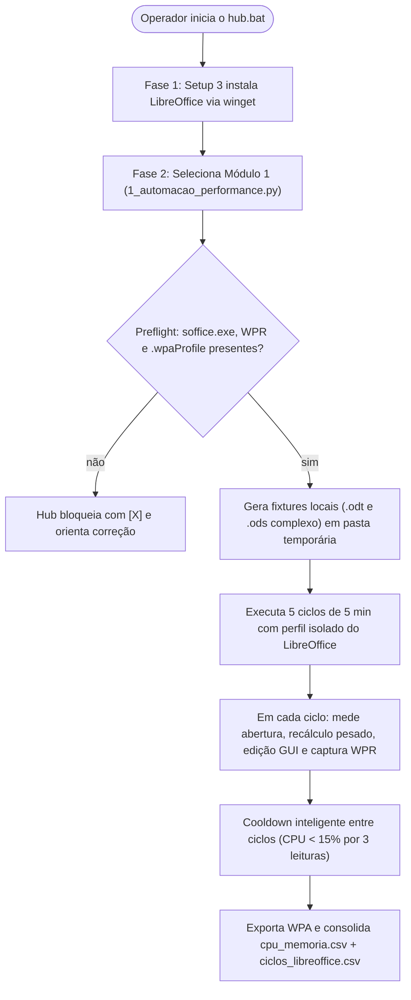

# 001 — Módulo 1 com workloads locais no LibreOffice

> **Em uma frase:** Substitui o workload web (Google Docs/Sheets no Edge) do Módulo 1 por automação 100% local e offline no LibreOffice (Writer e Calc), eliminando a necessidade de login no Google e medindo tempo de abertura dos aplicativos, tempo de cálculo de fórmulas complexas e consumo de CPU e RAM sob captura WPR/WPA.
>
> **Ideias de origem:** IDEIAS #1 · **Domínio:** testes / 1_cpu_memo · **Status:** mapeada

## 🎯 Problema e resultado

| Hoje | Quando estiver pronto |
|---|---|
| O Módulo 1 (`1_automacao_performance.py`) abre Google Docs, Google Sheets e um PDF online no Microsoft Edge, exigindo conta Google autenticada, conexão com a internet e intervenção manual do analista quando a sessão expira. | O Módulo 1 roda 100% automático e offline usando o LibreOffice instalado pelo Setup, sem login e sem internet. |
| O teste mede apenas o perfil WPR/WPA e o snapshot final de frequência/RAM, sem cronometrar o tempo de abertura dos apps de escritório nem o impacto dos agentes de segurança em cálculos pesados de planilha. | Cada um dos 5 ciclos cronometra o tempo de abertura do Writer e do Calc, o tempo de recálculo e exportação de uma planilha `.ods` com fórmulas complexas, e amostra continuamente CPU e RAM do sistema e dos processos do LibreOffice em conjunto com a captura WPR/WPA. |

## 👤 Fluxo de uso

1. Na Fase 1 (Preparação), o script `Setup/environment/3_softwares_msStore.ps1` garante a instalação silenciosa do `TheDocumentFoundation.LibreOffice` via `winget`.
2. Na Fase 2 (Testes), ao selecionar `1_automacao_performance.py`, a checagem antes da fila (`Get-PreflightFindings` no `hub.ps1`) valida a presença do `soffice.exe` (além de `wpr.exe`, `wpaexporter.exe` e `Agentes_SI_Profile.wpaProfile`).
3. O script gera localmente os arquivos de carga (um documento `.odt` base e uma planilha `.ods` com fórmulas complexas) e cria um diretório de perfil temporário do LibreOffice (`-env:UserInstallation=...`) para evitar assistentes de primeiro uso e conflito com perfis existentes.
4. Para cada um dos 5 ciclos (300 s de carga ativa + cooldown inteligente até 300 s):
   - Inicia a captura WPR (`Power.light` + `VirtualAllocation.light`) e o coletor `psutil` em thread dedicada (amostragem a cada 1 s de CPU % e RAM MB do sistema e da árvore `soffice.exe`/`soffice.bin`).
   - Cronometra a abertura do LibreOffice Writer (`soffice.exe --writer`) e do LibreOffice Calc (`soffice.exe --calc`) com os arquivos de carga até a janela principal estar visível e o processo estabilizado.
   - Executa a etapa cronometrada de cálculo pesado: dispara a abertura/recálculo completo e conversão/exportação da planilha `.ods` complexa (5.000 linhas com fórmulas `SUMIFS`, `VLOOKUP`, `INDEX/MATCH` e estatísticas cruzadas) para `.ods`/`.pdf` via instância dedicada do LibreOffice, registrando a duração exata em segundos.
   - Durante o restante da janela de 300 s do ciclo, alterna entre as janelas do Writer e do Calc simulando digitação de texto, formatação, preenchimento de células, recálculo forçado (`Ctrl+Shift+F9`) e salvamento em disco (`Ctrl+S`), acionando os hooks reais de arquivo, memória e teclado dos agentes de segurança (EDR/DLP/AV).
   - Ao fim dos 300 s, fecha as instâncias do LibreOffice do teste, salva o `.etl` do WPR, executa o `wpaexporter.exe` e aguarda o cooldown inteligente (3 leituras consecutivas de CPU < 15% a cada 10 s, teto de 300 s).
5. Ao concluir os 5 ciclos, consolida os CSVs do WPA em `Resultados_Consolidados/` e grava `cpu_memoria.csv` e `ciclos_libreoffice.csv` em `HUB_EVIDENCE_DIR`.

## ✅ Critérios de aceite

- [ ] `Setup/environment/3_softwares_msStore.ps1` inclui `TheDocumentFoundation.LibreOffice` na lista `$apps` instalada via `winget`.
- [ ] `Get-PreflightFindings` em `hub.ps1` emite achado `Impede` para `1_automacao_performance.py` quando `soffice.exe` não está no `PATH` nem em `C:\Program Files\LibreOffice\program\soffice.exe` (ou `Program Files (x86)`), orientando rodar o Setup 3.
- [ ] `Get-TestLeftovers` e `Stop-TestLeftovers` em `hub.ps1` detectam e encerram processos `soffice.exe`/`soffice.bin` abertos com o argumento de perfil temporário do teste (`wintesthub_lo_profile`), substituindo a associação de `msedge` ao módulo `1_cpu_memo`.
- [ ] `Testes/1_cpu_memo/1_automacao_performance.py` executa os 5 ciclos sem abrir o Microsoft Edge, sem usar `selenium` e sem exigir conexão com a internet ou login em conta Google/Microsoft.
- [ ] O script gera localmente, antes do Ciclo 1, a planilha `.ods` de benchmark contendo no mínimo 5.000 linhas de dados determinísticos (semente fixa `random.Random(42)`) e colunas calculadas com fórmulas (`SUM`, `AVERAGE`, `VLOOKUP`, `IF`, `COUNTIF`), sem depender de binários externos versionados no Git.
- [ ] Em cada ciclo, o script mede e registra: tempo de abertura do Writer (s), tempo de abertura do Calc (s), tempo de cálculo/exportação da planilha complexa (s), CPU média/pico do sistema (%), RAM média/pico do sistema (MB e %), CPU média/pico do LibreOffice (%) e RAM média/pico do LibreOffice (MB).
- [ ] A captura WPR (`Power.light` e `VirtualAllocation.light`), a exportação via `wpaexporter.exe` com `Agentes_SI_Profile.wpaProfile`, a parada segura com `Ctrl+Q` (`HUB_STOP_FILE`), o overlay click-through Tkinter e o cooldown inteligente continuam funcionando com o mesmo contrato de exit code (`0` = PASS somente se os 5 ciclos completarem sem erro; `1` = FAIL).
- [ ] O arquivo `cpu_memoria.csv` mantém todas as métricas legadas (`Ciclos_Executados`, `Duracao_Por_Ciclo`, `CPU_Frequencia_*`, `CPU_Nucleos_*`, `RAM_*`, `WPA_*`) e acrescenta as novas métricas de tempo de abertura, cálculo de fórmulas e consumo de CPU/RAM.
- [ ] O arquivo `ciclos_libreoffice.csv` é gerado em `HUB_EVIDENCE_DIR` com uma linha por ciclo (`1` a `5`) contendo todas as métricas individuais do ciclo.
- [ ] `README.md`, `docs/metodologia-de-testes.md` e `docs/manual-de-execucao.md` são atualizados refletindo o LibreOffice no Módulo 1, e `python docs/gerar_html.py --check` passa sem divergências.

## 🧭 Fronteira

| Dentro | Fora (e por quê) |
|---|---|
| `Testes/1_cpu_memo/1_automacao_performance.py`: substituição completa do Edge/Selenium/Google pelo LibreOffice Writer e Calc com geração local de `.odt` e `.ods` complexo. | `Testes/1_cpu_memo/1-1_automacao_performance_dlp.py`: permanece inalterado; já é 100% automático e offline (cópia de `.xlsx` de 100 MB para pendrive USB). |
| `Setup/environment/3_softwares_msStore.ps1`: adição do pacote `TheDocumentFoundation.LibreOffice` via `winget`. | `Testes/5_bateria/5_teste_bateria.py`: a fase de escritório do teste de bateria permanece como está (contrato da spec 003); eventual migração da bateria será tratada em spec própria. |
| `hub.ps1` e `.github/scripts/Test-Preflight.ps1`: checagem pré-fila do `soffice.exe` para `1_automacao_performance.py` e limpeza de sobras do LibreOffice do teste. | Reprovação automática por limite de tempo (`referencia.json` / teto 10x): o teste aprova pela conclusão íntegra dos 5 ciclos; a comparação de performance entre `ImagemLimpa` e `ComAgentes` é analítica via CSV/relatório. |
| Documentação (`README.md`, `docs/metodologia-de-testes.md`, `docs/manual-de-execucao.md` e HTMLs gerados). | Remoção do `selenium` de `5_install_py_dependencies.ps1`: os módulos 3 e 5 ainda utilizam Selenium + Edge. |

## 🔌 Contratos de dado e interface

### 1. Localização do executável do LibreOffice

Ordem de resolução do binário `soffice.exe`:
1. Variável de ambiente `HUB_LIBREOFFICE_PATH` (se definida e o arquivo existir).
2. `shutil.which("soffice.exe")` ou `shutil.which("soffice")`.
3. Caminhos padrão do Windows:
   - `C:\Program Files\LibreOffice\program\soffice.exe`
   - `C:\Program Files (x86)\LibreOffice\program\soffice.exe`

### 2. Isolamento de perfil e flags de execução

Todas as invocações do LibreOffice pelo teste devem passar:
- `-env:UserInstallation=file:///<caminho_temp_normalizado>/wintesthub_lo_profile` (perfil isolado em `%TEMP%`, recriado limpo no início de cada ciclo).
- `--norestore` `--nologo` `--nodefault` `--nolockcheck`.

Essa flag `wintesthub_lo_profile` na linha de comando identifica exclusivamente processos do LibreOffice abertos pelo teste, permitindo que `Get-TestLeftovers` no `hub.ps1` e o cleanup final do script encerrem apenas as instâncias do teste sem afetar documentos abertos pelo operador.

### 3. Contrato do CSV temático `cpu_memoria.csv`

Local: `<HUB_EVIDENCE_DIR>/cpu_memoria.csv` (UTF-8, separador `,`, cabeçalho `Metrica,Valor,Unidade`).

| Métrica | Tipo | Unidade | Descrição |
|---|---|---|---|
| `Versao_Teste` | string | `` | Fixo `2.0` (identifica o formato com LibreOffice) |
| `Ciclos_Executados` | int | `un` | Número de ciclos concluídos (`5`) |
| `Duracao_Por_Ciclo` | int | `s` | Duração da janela de carga por ciclo (`300`) |
| `Tempo_Abertura_Writer_Media` | float (`.2f`) | `s` | Média dos 5 ciclos para abertura do Writer com documento `.odt` |
| `Tempo_Abertura_Writer_Max` | float (`.2f`) | `s` | Maior tempo de abertura do Writer entre os 5 ciclos |
| `Tempo_Abertura_Calc_Media` | float (`.2f`) | `s` | Média dos 5 ciclos para abertura do Calc com planilha `.ods` |
| `Tempo_Abertura_Calc_Max` | float (`.2f`) | `s` | Maior tempo de abertura do Calc entre os 5 ciclos |
| `Tempo_Calculo_Formulas_Media` | float (`.2f`) | `s` | Média dos 5 ciclos para abertura, recálculo completo e exportação da planilha complexa |
| `Tempo_Calculo_Formulas_Max` | float (`.2f`) | `s` | Maior tempo de cálculo da planilha complexa entre os 5 ciclos |
| `Tempo_Calculo_Formulas_Min` | float (`.2f`) | `s` | Menor tempo de cálculo da planilha complexa entre os 5 ciclos |
| `CPU_Sistema_Media` | float (`.1f`) | `%` | Uso médio de CPU total da máquina durante os 5 ciclos de carga |
| `CPU_Sistema_Pico` | float (`.1f`) | `%` | Pico de CPU total da máquina durante os 5 ciclos de carga |
| `RAM_Sistema_Media_MB` | float (`.1f`) | `MB` | Uso médio de RAM do sistema durante os 5 ciclos de carga |
| `RAM_Sistema_Pico_MB` | float (`.1f`) | `MB` | Pico de RAM do sistema durante os 5 ciclos de carga |
| `LibreOffice_CPU_Media` | float (`.1f`) | `%` | Soma média de CPU dos processos `soffice.exe`/`soffice.bin` (normalizada por núcleos lógicos) |
| `LibreOffice_CPU_Pico` | float (`.1f`) | `%` | Pico de CPU dos processos `soffice.exe`/`soffice.bin` |
| `LibreOffice_RAM_Media_MB` | float (`.1f`) | `MB` | Soma média de RSS (`memory_info().rss`) dos processos `soffice.exe`/`soffice.bin` |
| `LibreOffice_RAM_Pico_MB` | float (`.1f`) | `MB` | Pico de RSS dos processos `soffice.exe`/`soffice.bin` |
| `CPU_Frequencia_Atual` … `RAM_Uso_Percentual` | legado | legado | Colunas originais mantidas para retrocompatibilidade |
| `WPA_<Arquivo>_<Metrica>_{Media,Max,Min}` | legado | `` | Métricas consolidadas do `wpaexporter.exe` (quando `.wpaProfile` está presente) |

### 4. Contrato do CSV detalhado por ciclo `ciclos_libreoffice.csv`

Local: `<HUB_EVIDENCE_DIR>/ciclos_libreoffice.csv` (UTF-8, separador `,`).

Colunas obrigatórias:
`Ciclo,Timestamp_Inicio,Tempo_Abertura_Writer_s,Tempo_Abertura_Calc_s,Tempo_Calculo_Formulas_s,Linhas_Editadas_Calc,Paragrafos_Digitados_Writer,CPU_Sistema_Media_Pct,CPU_Sistema_Pico_Pct,RAM_Sistema_Media_MB,RAM_Sistema_Pico_MB,LibreOffice_CPU_Media_Pct,LibreOffice_CPU_Pico_Pct,LibreOffice_RAM_Media_MB,LibreOffice_RAM_Pico_MB,Cooldown_Duracao_s`

## ⚠️ Casos de borda

| Situação | Comportamento esperado |
|---|---|
| `soffice.exe` ausente na máquina | Na checagem pré-fila do `hub.ps1`, aparece como `[X] Impede` apenas para `1_automacao_performance.py` (não bloqueia `1-1_automacao_performance_dlp.py`). Na execução avulsa, o script falha no `check_prerequisites()` com exit code `1` e mensagem clara no log. |
| Primeiro uso do LibreOffice ou diálogo de recuperação de documento após crash anterior | O uso de `-env:UserInstallation` em pasta temporária limpa a cada ciclo + `--norestore` `--nologo` elimina o wizard inicial e o diálogo de recuperação de arquivos. |
| Processo do LibreOffice trava durante o recálculo de fórmulas complexas | A etapa de recálculo em lote tem timeout de 180 s; se estourar, encerra a árvore de processos do LibreOffice, cancela o WPR e encerra o teste com FAIL (`exit code 1`). |
| `Agentes_SI_Profile.wpaProfile` ausente na pasta `Testes/1_cpu_memo/` | Em execução avulsa, o teste registra aviso no log, grava os `.etl` e gera `cpu_memoria.csv` e `ciclos_libreoffice.csv` normalmente com as métricas de tempo e `psutil` (deixando o módulo não-vazio na pasta `Exportar/`). No hub, o preflight continua apontando o `.wpaProfile` ausente antes da fila. |
| Operador pressiona `Ctrl+Q` ou aciona o FailSafe do PyAutoGUI | Cancela imediatamente a sessão WPR ativa, encerra os processos `soffice.exe`/`soffice.bin` do perfil temporário, remove a pasta temporária do perfil, grava `HUB_STOP_FILE` e sai com código `1` (FAIL). |

## 🧱 Stack e convenções do workspace

- **Runtime:** Python 3.12 (`.venv` criado por `Setup/environment/5_install_py_dependencies.ps1`) e Windows PowerShell 5.1 (`hub.ps1`, `Setup/`).
- **Bibliotecas Python já instaladas no `.venv`:** `psutil`, `pyautogui`, `pyperclip`, `pandas`, `pynput`, `tkinter` (stdlib), `zipfile` e `xml.etree.ElementTree` (stdlib). Nenhuma dependência Python nova é necessária.
- **Convenção de saída e logs:** logs e `print` no console sem caracteres fora da página `cp1252` (ou com `sys.stdout.reconfigure(errors="replace")`); exit code definido na thread principal (`sys.exit(_exit_code)`).
- **Testes de CI (`.github/workflows/ci.yml`):**
  - Sintaxe Python (`py_compile`) e PowerShell (`PSScriptAnalyzer`).
  - `.github/scripts/Test-Preflight.ps1` (testa `Get-PreflightFindings` e `Get-TestLeftovers` com mocks).
  - `.github/scripts/Test-ThematicCSVs.ps1` (valida `cpu_memoria.csv`).
  - `python docs/gerar_html.py --check` (valida sincronia entre `docs/*.md` e `docs/*.html`).

## 📦 Soluções open source avaliadas

| Projeto | O que resolve | Licença | Última release | Adoção | Veredito |
|---|---|---|---|---|---|
| [`psutil`](https://github.com/giampaolo/psutil) + [`pyautogui`](https://github.com/asweigart/pyautogui) + stdlib `zipfile`/XML | Geração de arquivos ODF (`.odt`/`.ods`), automação da GUI real do LibreOffice e amostragem de CPU/RAM por processo | BSD-3-Clause / BSD | `7.2.2` / `0.9.54` | ~300M+ e ~2.5M downloads/mês (já no projeto) | **adotar** (já em uso) |
| [`ooo-dev-tools`](https://github.com/Amourspirit/python_ooo_dev_tools) (`pyuno`) | Wrapper orientado a objetos sobre a bridge Python-UNO do LibreOffice | Apache-2.0 | `0.53.4` (mai/2025) | ~51 stars | **descartar** (exige acoplar o Python interno do LibreOffice ao `.venv` no Windows e opera via socket sem exercitar a GUI completa) |
| [`pywinauto`](https://github.com/pywinauto/pywinauto) | Automação de janelas nativas Win32/UIA no Windows | BSD-3-Clause | `0.6.9` (jan/2025) | ~6.5k stars | **descartar** (adicionaria dependência nativa pesada quando `pyautogui` + linha de comando do `soffice.exe` já atendem) |
| [`odfpy`](https://pypi.org/project/odfpy/) | Criação e leitura programática de arquivos `.odt` e `.ods` | Apache-2.0 / GPL / LGPL | `1.4.1` | ~5.1M downloads/mês | **inspirar** (um `.ods`/`.odt` mínimo é apenas um ZIP com `mimetype` e `content.xml`; gerar direto com `zipfile` da stdlib evita nova dependência e dual-license GPL) |

**Decisão:** Construir sobre a stack já instalada no projeto (`psutil`, `pyautogui`, `pyperclip`, `pandas` e `zipfile`/XML da stdlib) + CLI do LibreOffice (`soffice.exe`) — zero dependência Python nova e fidelidade total ao uso real de desktop monitorado por agentes de segurança.

## 🧾 Decisões

| Decisão | Alternativas rejeitadas | Porquê | Custo de reverter |
|---|---|---|---|
| Gerar `.odt` e `.ods` complexo via `zipfile` + `content.xml` nativo do Python | Adicionar `odfpy` ao `5_install_py_dependencies.ps1` ou versionar binários `.ods` grandes no Git | Um arquivo ODF válido precisa apenas de `mimetype`, `META-INF/manifest.xml` e `content.xml` no ZIP; gera planilhas de milhares de linhas com fórmulas em < 1 s sem pesar o repositório nem adicionar pacote ao setup | Baixo (isolado na função geradora de fixtures do script) |
| Medir a abertura dos apps pela detecção do processo `soffice.bin` + janela ativa estabilizada e o cálculo pesado via execução dedicada `soffice.exe --headless --convert-to pdf` da planilha `.ods` com recálculo | Medir cálculo apenas por `pyautogui` olhando a barra de status na tela | A conversão/exportação da planilha `.ods` gerada com fórmulas não-cacheadas obriga o motor do Calc (`soffice.bin`) a abrir, avaliar todas as fórmulas e gravar a saída, fornecendo um tempo determinístico ao milissegundo, enquanto a etapa seguinte exercita a GUI interativa | Baixo (ambas as etapas rodam dentro do mesmo ciclo) |
| Usar `-env:UserInstallation` em diretório temporário por ciclo (`wintesthub_lo_profile`) | Usar o perfil padrão do usuário no Windows (`%APPDATA%\LibreOffice`) | Evita popups de boas-vindas/recuperação de falha, garante *cold start* consistente em todos os 5 ciclos e permite ao `hub.ps1` identificar sobras do teste pela linha de comando sem matar janelas do usuário | Baixo (parâmetro de linha de comando) |
| Checar `soffice.exe` no preflight apenas para `1_automacao_performance.py` (e não para a pasta inteira `1_cpu_memo`) | Exigir `soffice.exe` para toda a pasta `1_cpu_memo` | A variante `1-1_automacao_performance_dlp.py` divide a pasta `1_cpu_memo`, mas só faz cópias de arquivo para USB e não usa LibreOffice | Baixo (filtro por nome do script em `Get-PreflightFindings`) |

## ❓ Em aberto

Não se aplica — todos os pontos foram fechados na descoberta.

## 🔬 Evidência de validação

- Execução de `.github/scripts/Test-Preflight.ps1` e `.github/scripts/Test-ThematicCSVs.ps1` passando com novos casos de teste cobrindo `soffice.exe` ausente/presente e sobras do LibreOffice (`wintesthub_lo_profile`).
- Teste unitário em Python validando:
  1. Geração determinística dos arquivos `.odt` e `.ods` com 5.000 linhas e fórmulas válidas.
  2. Geração dos arquivos `cpu_memoria.csv` e `ciclos_libreoffice.csv` com todas as colunas exigidas no contrato.
- Execução de `python docs/gerar_html.py --check` e `py_compile` sem erros.

## 🔗 Dependências e handoff

- **Depende de:** nenhuma outra spec pendente.
- **Condição para começar:** pronta para execução imediata.
- **Fronteiras de arquivo sugeridas para execução:**
  - Frente 1 (Módulo Python + testes unitários): `Testes/1_cpu_memo/1_automacao_performance.py` e `tests/test_cpu_memo_libreoffice.py` (ou `.github/scripts/`).
  - Frente 2 (Setup + Orquestrador PowerShell + testes de preflight): `Setup/environment/3_softwares_msStore.ps1`, `hub.ps1` e `.github/scripts/Test-Preflight.ps1`.
  - Frente 3 (Documentação): `README.md`, `docs/metodologia-de-testes.md`, `docs/manual-de-execucao.md` e HTMLs gerados via `docs/gerar_html.py`.
