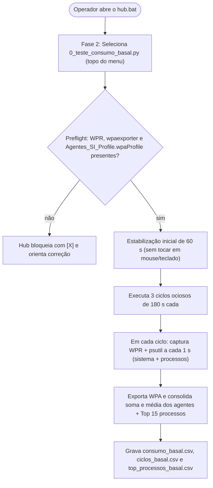

# 002 — Teste 0 de consumo basal (CPU e RAM em repouso)

> **Em uma frase:** Cria o Módulo 0 (`0_teste_consumo_basal.py`) para medir o consumo basal de CPU e RAM da máquina em repouso (sistema total, ranking dos 15 processos mais pesados via `psutil` e detalhamento/soma dos agentes de segurança via WPR/WPA), permitindo comparar o peso da imagem limpa contra a imagem com agentes de segurança instalados.
>
> **Ideias de origem:** IDEIAS #2 · **Domínio:** testes / 0_consumo_basal · **Status:** mapeada

## 🎯 Problema e resultado

| Hoje | Quando estiver pronto |
|---|---|
| Não existe um módulo que meça a máquina 100% parada; os módulos 1 e 1.1 só medem sob carga de trabalho e o `cpu_memoria.csv` antigo apenas isolava processos do `.wpaProfile` sem registrar a curva basal total do sistema. | O Teste 0 (`0_teste_consumo_basal.py`) aparece no topo da Fase 2 do hub e mede a máquina em repouso por 3 ciclos de 3 minutos após estabilização inicial. |
| O analista não consegue responder com evidência rastreável quanto de CPU e RAM a máquina gasta parada antes e depois de instalar os agentes de segurança (EDR, DLP, AV, Zero Trust). | O teste gera `consumo_basal.csv`, `ciclos_basal.csv`, `top_processos_basal.csv` e a consolidação do WPA (com média **e soma** dos processos do `.wpaProfile`), separando o consumo basal total do Windows e a fatia exata dos agentes de segurança. |

## 👤 Fluxo de uso

1. Na Fase 2 (Testes), o módulo **Consumo Basal** (`Testes/0_consumo_basal/0_teste_consumo_basal.py`) aparece como o primeiro item do menu (antes do Módulo 1).
2. A checagem antes da fila (`Get-PreflightFindings` no `hub.ps1`) valida a presença de `wpr.exe`, `wpaexporter.exe` e do perfil `Agentes_SI_Profile.wpaProfile` (procurado primeiro em `Testes/1_cpu_memo/` e, como fallback, em `Testes/0_consumo_basal/`).
3. Ao iniciar `0_teste_consumo_basal.py`, o `hub.ps1` **não** inicia o `CpuSampler` externo em PowerShell (`0_consumo_basal` fica em `CpuSampler.SkipFolders`), evitando ruído de consultas WMI paralelas durante a coleta ociosa.
4. O script exibe o overlay click-through Tkinter (`"Não utilize mouse ou teclado — medindo consumo basal"`) e executa uma **estabilização inicial de 60 s** (aguardando o próprio pico de inicialização do Python/Tkinter dissipar).
5. Em seguida, executa **3 ciclos de 180 s (3 minutos) de ociosidade** (com intervalo/cooldown de 30 s entre ciclos):
   - Inicia a captura WPR (`wpr.exe -start Power.light -start VirtualAllocation.light -filemode -compress`).
   - A cada `1.0 s`, amostra via `psutil`:
     - CPU total do sistema (`%`) e frequência atual (`MHz`).
     - RAM usada do sistema (`MB` e `%`) e RAM disponível (`MB`).
     - Uso de CPU (`%` normalizado pelo número de núcleos lógicos) e RAM RSS (`MB`) de cada processo ativo (excluindo `System Idle Process` / PID 0 e o próprio processo Python do Teste 0).
   - Monitora eventos de teclado e movimentação de mouse: qualquer interação do operador (exceto `Ctrl+Q`, que interrompe o teste) incrementa o contador de desvios do ciclo e registra aviso no log e no CSV (`Interacao_Detectada = sim`), sem abortar o ciclo.
   - Ao fim dos 180 s, salva o trace `Trace_Basal_<ts>_Run<N>.etl` e executa o `wpaexporter.exe` com `Agentes_SI_Profile.wpaProfile`.
6. Concluídos os 3 ciclos, consolida as amostras `psutil` e os CSVs exportados pelo WPA, gravando `consumo_basal.csv`, `ciclos_basal.csv`, `top_processos_basal.csv` e `Resultados_Consolidados/` em `HUB_EVIDENCE_DIR`.

## ✅ Critérios de aceite

- [ ] O script `Testes/0_consumo_basal/0_teste_consumo_basal.py` existe e aparece como o primeiro teste listado na Fase 2 pelo `Get-Scripts` do `hub.ps1`.
- [ ] `config.json` e o fallback padrão em `hub.ps1` incluem `"0_consumo_basal"` em `CpuSampler.SkipFolders`.
- [ ] `Test-ThematicCSVs` em `hub.ps1` (e `.github/scripts/Test-ThematicCSVs.ps1`) registra `"0_consumo_basal" = "consumo_basal.csv"`.
- [ ] `Get-PreflightFindings` em `hub.ps1` verifica `wpr.exe`, `wpaexporter.exe` e a existência de `Agentes_SI_Profile.wpaProfile` (aceitando o arquivo em `Testes/1_cpu_memo/` ou em `Testes/0_consumo_basal/`) quando `0_consumo_basal` está selecionado.
- [ ] `Get-TestLeftovers` em `hub.ps1` associa sobras de `wpr` e `wpaexporter` também à pasta `0_consumo_basal`.
- [ ] O script realiza 60 s de estabilização inicial e 3 ciclos de 180 s de coleta ociosa com amostragem de 1 s via `psutil` e captura WPR (`Power.light` + `VirtualAllocation.light`).
- [ ] O consumo do próprio processo Python do Teste 0 (`os.getpid()`) é registrado separadamente e excluído do ranking `top_processos_basal.csv` para não mascarar os processos do sistema e dos agentes.
- [ ] A consolidação do WPA em `Resultados_Consolidados/` e em `consumo_basal.csv` calcula tanto a **média por processo** quanto a **soma total dos processos exportados pelo `.wpaProfile`** (`WPA_<Arquivo>_<Metrica>_Soma_Media`), permitindo enxergar o peso agregado de todos os agentes de segurança.
- [ ] O teste suporta parada segura com `Ctrl+Q` (`HUB_STOP_FILE`), cancelando o WPR ativo e saindo com exit code `1` (FAIL).
- [ ] O teste retorna exit code `0` (PASS) somente se os 3 ciclos completarem sem erro e gerarem `consumo_basal.csv`, `ciclos_basal.csv` e `top_processos_basal.csv`.
- [ ] `README.md`, `docs/metodologia-de-testes.md` e `docs/manual-de-execucao.md` documentam o Módulo 0, e `python docs/gerar_html.py --check` passa sem divergências.

## 🧭 Fronteira

| Dentro | Fora (e por quê) |
|---|---|
| `Testes/0_consumo_basal/0_teste_consumo_basal.py`: coleta ociosa em 3 ciclos de 180 s com `psutil` (sistema + Top 15 processos) e WPR/WPA. | Encerramento forçado de aplicativos do usuário ou serviços do Windows antes do teste: o teste mede o estado basal real da máquina (sobras de testes anteriores já são encerradas pelo `hub.ps1`). |
| Reuso automático de `Testes/1_cpu_memo/Agentes_SI_Profile.wpaProfile` (com fallback local em `Testes/0_consumo_basal/`). | Criação de um novo arquivo `.wpaProfile` exclusivo: evita duplicar trabalho manual de distribuição de arquivo não versionado. |
| Integração em `hub.ps1` (`Test-ThematicCSVs`, `Get-PreflightFindings`, `Get-TestLeftovers`, `CpuSampler.SkipFolders`) e `config.json`. | Comparação automática cruzando pastas de cenários diferentes (`ImagemLimpa` × `ComAgentes`): cada cenário gera seu `consumo_basal.csv` padronizado para cruzamento nos relatórios/BI. |
| Atualização de `README.md`, `docs/metodologia-de-testes.md`, `docs/manual-de-execucao.md` e HTMLs gerados. | Medição de descarga de bateria em repouso: já faz parte da fase ociosa de 60 min do Módulo 5 (`5_teste_bateria.py`). |

## 🔌 Contratos de dado e interface

### 1. Resolução do `Agentes_SI_Profile.wpaProfile`

Ordem de busca pelo script `0_teste_consumo_basal.py` e pela checagem `Get-PreflightFindings`:
1. `Testes/0_consumo_basal/Agentes_SI_Profile.wpaProfile` (ou `.wpaProfile.xml`, renomeado automaticamente).
2. `Testes/1_cpu_memo/Agentes_SI_Profile.wpaProfile` (ou `.wpaProfile.xml`, renomeado automaticamente).

### 2. Contrato do CSV temático `consumo_basal.csv`

Local: `<HUB_EVIDENCE_DIR>/consumo_basal.csv` (UTF-8, separador `,`, cabeçalho `Metrica,Valor,Unidade`).

| Métrica | Tipo | Unidade | Descrição |
|---|---|---|---|
| `Versao_Teste` | string | `` | Fixo `1.0` |
| `Ciclos_Executados` | int | `un` | Quantidade de ciclos ociosos concluídos (`3`) |
| `Duracao_Por_Ciclo` | int | `s` | Duração de cada ciclo ocioso (`180`) |
| `Estabilizacao_Inicial` | int | `s` | Tempo de estabilização antes do Ciclo 1 (`60`) |
| `Amostras_Totais` | int | `un` | Total de amostras de 1 s coletadas nos 3 ciclos (`~540`) |
| `Interacao_Humana_Detectada` | string | `` | `nao` ou `sim` (se houve movimento de mouse ou tecla durante a medição) |
| `CPU_Sistema_Media` | float (`.2f`) | `%` | Média de uso total de CPU da máquina em repouso |
| `CPU_Sistema_Mediana` | float (`.2f`) | `%` | Mediana de uso total de CPU da máquina em repouso |
| `CPU_Sistema_P95` | float (`.2f`) | `%` | Percentil 95 de uso total de CPU da máquina em repouso |
| `CPU_Sistema_Pico` | float (`.2f`) | `%` | Maior leitura de CPU total nos 3 ciclos |
| `CPU_Sistema_Min` | float (`.2f`) | `%` | Menor leitura de CPU total nos 3 ciclos |
| `RAM_Total_GB` | float (`.2f`) | `GB` | Memória física total instalada |
| `RAM_Usada_Media_MB` | float (`.1f`) | `MB` | Média de RAM física em uso (`used`) durante o repouso |
| `RAM_Usada_Mediana_MB` | float (`.1f`) | `MB` | Mediana de RAM física em uso durante o repouso |
| `RAM_Usada_Pico_MB` | float (`.1f`) | `MB` | Pico de RAM física em uso durante o repouso |
| `RAM_Usada_Media_Pct` | float (`.1f`) | `%` | Percentual médio de RAM em uso durante o repouso |
| `RAM_Disponivel_Media_GB` | float (`.2f`) | `GB` | Média de RAM disponível (`available`) durante o repouso |
| `Self_Overhead_CPU_Media` | float (`.2f`) | `%` | Consumo médio de CPU do próprio processo do Teste 0 |
| `Self_Overhead_RAM_Media_MB` | float (`.1f`) | `MB` | Consumo médio de RAM RSS do próprio processo do Teste 0 |
| `Top1_CPU_Processo` | string | `` | Nome do processo (exceto Idle e Teste 0) com maior CPU média |
| `Top1_CPU_Media` | float (`.2f`) | `%` | CPU média do processo `Top1_CPU_Processo` |
| `Top1_RAM_Processo` | string | `` | Nome do processo (exceto Teste 0) com maior RAM RSS média |
| `Top1_RAM_Media_MB` | float (`.1f`) | `MB` | RAM RSS média do processo `Top1_RAM_Processo` |
| `WPA_<Arquivo>_<Metrica>_Soma_Media` | float (`.2f`) | `` | Soma total de todos os processos do `.wpaProfile` na métrica (média dos 3 ciclos) |
| `WPA_<Arquivo>_<Metrica>_Media` | float (`.2f`) | `` | Média por processo do `.wpaProfile` na métrica |
| `WPA_<Arquivo>_<Metrica>_Max` | float (`.2f`) | `` | Valor do processo mais pesado do `.wpaProfile` na métrica |

### 3. Contrato do CSV por ciclo `ciclos_basal.csv`

Local: `<HUB_EVIDENCE_DIR>/ciclos_basal.csv` (UTF-8, separador `,`).

Colunas obrigatórias:
`Ciclo,Timestamp_Inicio,Duracao_s,Amostras,Interacao_Detectada,CPU_Media_Pct,CPU_Mediana_Pct,CPU_P95_Pct,CPU_Pico_Pct,RAM_Usada_Media_MB,RAM_Usada_Pico_MB,RAM_Usada_Media_Pct`

### 4. Contrato do ranking de processos `top_processos_basal.csv`

Local: `<HUB_EVIDENCE_DIR>/top_processos_basal.csv` (UTF-8, separador `,`).
Agrupa processos pelo nome do executável (somando instâncias com mesmo nome, ex.: `svchost.exe` ou múltiplos workers de um agente) e lista os **Top 15 por CPU média** e os **Top 15 por RAM média** ao longo dos 3 ciclos:

Colunas obrigatórias:
`Ranking_Por,Posicao,Processo,Instancias_Medias,CPU_Media_Pct,CPU_Pico_Pct,RAM_RSS_Media_MB,RAM_RSS_Pico_MB`

## ⚠️ Casos de borda

| Situação | Comportamento esperado |
|---|---|
| Operador esbarra no mouse ou teclado durante um ciclo ocioso | O listener `pynput` (mouse + teclado) marca `Interacao_Detectada = sim` no ciclo e `Interacao_Humana_Detectada = sim` no `consumo_basal.csv`, registrando `WARNING` no log, mas não interrompe nem reprova o teste. |
| `Agentes_SI_Profile.wpaProfile` existe em `Testes/1_cpu_memo/` mas não em `Testes/0_consumo_basal/` | Tanto o preflight do `hub.ps1` quanto o `0_teste_consumo_basal.py` encontram e usam automaticamente o arquivo de `Testes/1_cpu_memo/`. |
| `Agentes_SI_Profile.wpaProfile` ausente nas duas pastas (ou execução em `ImagemLimpa` onde nenhum processo do filtro do `.wpaProfile` aparece no CSV exportado) | Se o `.wpaProfile` estiver ausente em execução avulsa, ou se o CSV exportado pelo WPA vier vazio (0 processos encontrados na `ImagemLimpa`), o teste **não** falha: gera `consumo_basal.csv`, `ciclos_basal.csv` e `top_processos_basal.csv` completos com os dados do `psutil` e registra `0.00` nas métricas `WPA_*_Soma_Media`. |
| Processos que nascem ou morrem no meio de um ciclo ocioso (`psutil.NoSuchProcess` / `psutil.AccessDenied`) | Exceções por processo são ignoradas silenciosamente na iteração sem descartar a amostra global do segundo atual. |
| Operador pressiona `Ctrl+Q` | Cancela imediatamente a captura WPR (`wpr.exe -cancel`), grava o sinal em `HUB_STOP_FILE`, fecha o overlay e encerra com exit code `1` (FAIL). |

## 🧱 Stack e convenções do workspace

- **Runtime:** Python 3.12 (`.venv`) e Windows PowerShell 5.1 (`hub.ps1`).
- **Bibliotecas Python utilizadas:** `psutil`, `pandas`, `pynput`, `tkinter` (todas já instaladas por `Setup/environment/5_install_py_dependencies.ps1`).
- **Integração com `hub.ps1`:**
  - `Get-Scripts` descobre `Testes/0_consumo_basal/0_teste_consumo_basal.py` automaticamente e o posiciona no índice 0 do menu (`Get-NaturalSortKey`).
  - `CpuSampler.SkipFolders` inclui `"0_consumo_basal"` para não executar `Start-CpuSampler` durante a medição basal.
  - `Test-ThematicCSVs` verifica `0_consumo_basal/consumo_basal.csv`.

## 📦 Soluções open source avaliadas

| Projeto | O que resolve | Licença | Última release | Adoção | Veredito |
|---|---|---|---|---|---|
| [`psutil`](https://github.com/giampaolo/psutil) + WPT (`wpr.exe` / `wpaexporter.exe`) | Amostragem de CPU/RAM global e por processo no Windows + trace ETW de kernel para agentes de segurança | BSD-3-Clause | `7.2.2` | ~300M+ downloads/mês (já no projeto) | **adotar** (já em uso) |
| [`Hillary520/python_system_monitor`](https://github.com/Hillary520/python_system_monitor) | Monitor TUI de recursos do sistema com `psutil` e `asyncio` | MIT | 2024 | Referência GitHub | **descartar** (focado em TUI interativa, sem exportação CSV/WPA) |
| [`ashyadav108/CPU-Memory-use-by-Application`](https://github.com/ashyadav108/CPU-Memory-use-by-Application) | Script simples de rastreamento de CPU e memória por PID com `psutil` | — | — | Referência GitHub | **inspirar** (apenas o padrão de loop de amostragem por processo com `psutil.process_iter`) |

**Decisão:** Construir com `psutil`, `pandas`, `pynput` e `wpr.exe`/`wpaexporter.exe` já presentes no projeto — zero dependência nova e compatibilidade total com os relatórios do hub e do WPA.

## 🧾 Decisões

| Decisão | Alternativas rejeitadas | Porquê | Custo de reverter |
|---|---|---|---|
| 60 s de estabilização inicial + 3 ciclos de 180 s com cooldown de 30 s (~10,5 min total) | 1 ciclo único de 60 s ou 1 ciclo longo de 60 min | 60 s únicos sofrem distorção de qualquer tarefa agendada pontual do Windows; 60 min já existem no teste de bateria. 3 × 180 s permitem comparar a consistência entre ciclos e calcular mediana e P95 com 540 amostras em ~10 min | Baixo (constantes no topo do script) |
| Calcular `Soma_Media` além de `Media` nos CSVs do WPA e medir o total da máquina via `psutil` | Usar apenas a média das linhas exportadas pelo WPA (como fazia o Módulo 1 legado) | O `.wpaProfile` filtra os processos dos agentes; somar os processos do WPA mostra o peso agregado de todos os agentes, enquanto o `psutil` mostra o consumo total da máquina (que funciona tanto na `ImagemLimpa` quanto `ComAgentes`) | Baixo (função `consolidate_results`) |
| Reusar `Testes/1_cpu_memo/Agentes_SI_Profile.wpaProfile` quando não houver cópia em `Testes/0_consumo_basal/` | Exigir cópia duplicada do `.wpaProfile` na pasta `0_consumo_basal/` | Evita erro operacional ao preparar a máquina e mantém um único perfil de agentes de segurança para manter | Baixo (busca em lista de 2 caminhos) |
| Incluir `"0_consumo_basal"` em `CpuSampler.SkipFolders` no `config.json` e `hub.ps1` | Deixar o `Start-CpuSampler` do `hub.ps1` rodando durante o Teste 0 | O `Start-CpuSampler` cria um `powershell.exe` em background fazendo queries CIM a cada 5 s, o que adicionaria consumo artificial de CPU e RAM exatamente durante a medição de repouso | Baixo (1 item na lista `SkipFolders`) |

## ❓ Em aberto

Não se aplica — todos os pontos foram fechados na descoberta.

## 🔬 Evidência de validação

- Execução de `.github/scripts/Test-Preflight.ps1`, `.github/scripts/Test-ThematicCSVs.ps1` e `.github/scripts/Test-GetScriptsOrder.ps1` passando com `0_consumo_basal` incluído.
- Teste unitário em Python validando a consolidação de amostras `psutil` + WPA (incluindo o caso de `ImagemLimpa` com CSV do WPA vazio) e a geração de `consumo_basal.csv`, `ciclos_basal.csv` e `top_processos_basal.csv`.
- Execução de `python docs/gerar_html.py --check` e `py_compile` sem erros.

## 🔗 Dependências e handoff

- **Depende de:** nenhuma outra spec (independente da Spec 001).
- **Condição para começar:** pronta para execução imediata.
- **Fronteiras de arquivo sugeridas para execução:**
  - Frente 1 (Novo módulo Python + testes unitários): `Testes/0_consumo_basal/0_teste_consumo_basal.py` e `tests/test_consumo_basal.py`.
  - Frente 2 (Orquestrador PowerShell + config + testes CI): `hub.ps1`, `config.json`, `.github/scripts/Test-Preflight.ps1`, `.github/scripts/Test-ThematicCSVs.ps1` e `.github/scripts/Test-GetScriptsOrder.ps1`.
  - Frente 3 (Documentação): `README.md`, `docs/metodologia-de-testes.md`, `docs/manual-de-execucao.md` e HTMLs gerados via `docs/gerar_html.py`.
