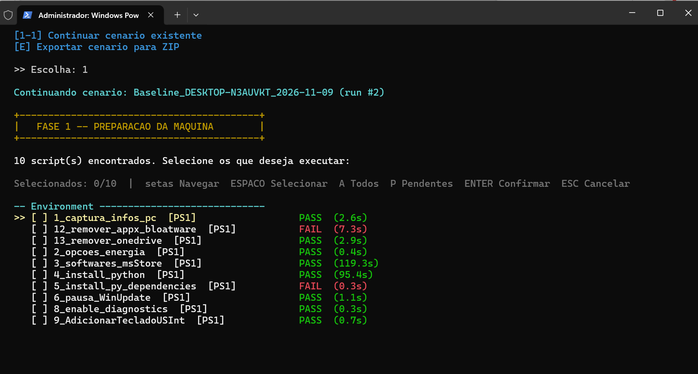
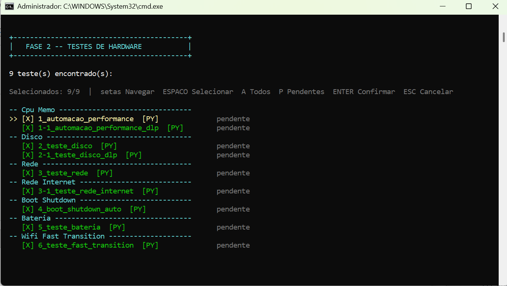
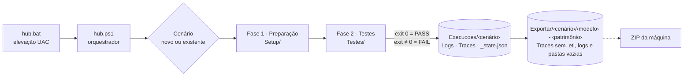
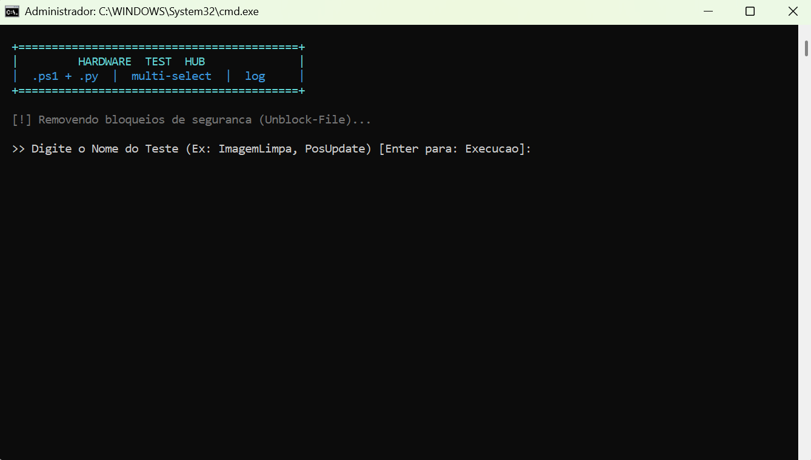
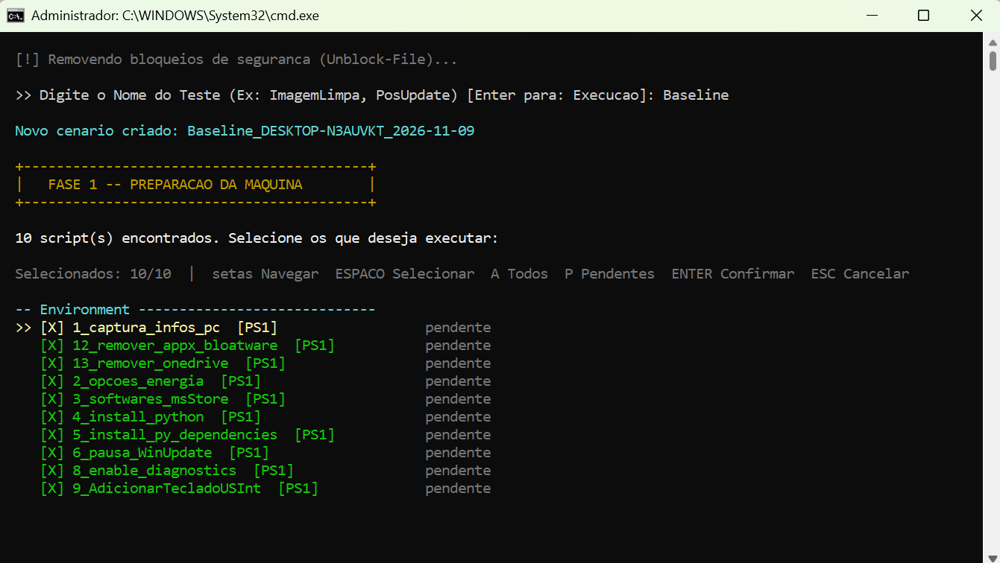
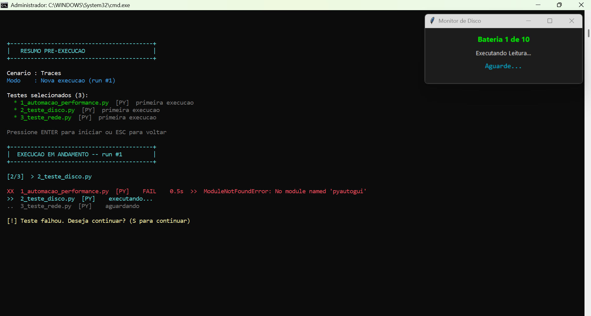
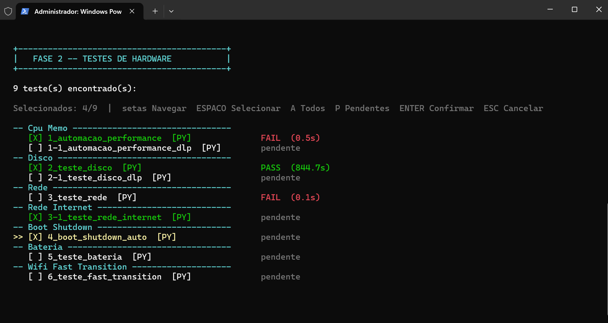

<div align="center">

<picture>
  <source media="(prefers-color-scheme: dark)" srcset="docs/assets/brand/logo-dark.svg">
  
</picture>

<h1>WinTestHub</h1>

**Hardware Test Hub: framework para validação de hardware em máquinas Windows.**<br>
Prepara o ambiente, executa testes de CPU, memória, disco, rede, boot, bateria e Wi-Fi e gera relatórios rastreáveis por cenário.

[](https://github.com/AndreRenatoMenezes/win_testehub/actions/workflows/ci.yml)
[](https://github.com/AndreRenatoMenezes/win_testehub/releases)


[Início rápido](#início-rápido) · [Módulos](#módulos-de-teste) · [Saídas](#saídas-e-relatórios) · [Documentação](#documentação) · [Contribuir](CONTRIBUTING.md)

</div>

---

## Sobre

O **WinTestHub** (Hardware Test Hub) padroniza a homologação de notebooks e desktops Windows. Um único ponto de entrada (`hub.bat`) eleva os privilégios, prepara a máquina e abre um menu no console onde o operador escolhe os testes. Cada teste é um script independente, que devolve PASS/FAIL pelo exit code e grava evidências numa pasta controlada pelo hub.

Os resultados ficam agrupados em **cenários** (por exemplo, `ImagemLimpa` × `ComAgentes`). Assim dá para comparar a mesma máquina em configurações diferentes, retomar uma bateria de testes em outro dia e reexecutar só o que falhou, sem perder nenhuma evidência.


<br><sub>*Retomando um cenário (run #2): o menu mostra o último resultado e a duração de cada script.*</sub>

### Destaques

- **Menu interativo**: seleção múltipla por setas e espaço. Na Fase 2 os testes ficam em três seções (**Escritório**, **Dev** e **Opcional**); só os pendentes de Escritório já vêm marcados, `1`/`2`/`3` ligam ou desligam uma seção inteira, `A` marca todos e `P` volta a marcar só os pendentes de Escritório.
- **Duas fases**: preparação da máquina (energia, Windows Update, Python, bloatware…) e testes de hardware.
- **Cenários persistentes**: o histórico de execuções fica em `_state.json`. Numa reexecução, as evidências anteriores vão para `_anterior/` em vez de serem sobrescritas.
- **Relatórios em vários formatos**: HTML, CSV, JSON e log completo, por execução e consolidados por cenário, além de CSVs temáticos prontos para BI.
- **Extensível por convenção**: qualquer `.py` ou `.ps1` colocado em `Testes/` vira um item do menu.
- **Feito para o operador**: overlays de progresso que não capturam cliques, parada segura com `Ctrl+Q` e pasta de exportação pronta para o Drive (sem `.etl` nem logs) e ZIP validado.
- **Checagem antes da fila**: antes de soltar a fila, o hub aponta o que vai falhar (ex.: `.wpaProfile` ausente, ferramenta de dev faltando, notebook na bateria) e as sobras de testes anteriores consumindo recursos. Entre um teste e outro, limpa as sobras do teste que acabou.
- **Monitor ao vivo no terminal**: durante a Fase 2, uma TUI (`rich`) mostra a fila com cronômetros, a etapa interna de cada teste (`[HUB:PROGRESS]`), CPU/clock/temperatura/RAM/energia, as últimas linhas de log e os alertas. Nos testes 0 e 5 entra em modo baixo impacto; sem `rich` no `.venv`, o hub volta ao painel clássico.
- **Avisos e frequência da CPU no relatório**: o `_relatorio.html` lista as ressalvas da rodada e o clock da CPU por módulo, com aviso de throttling.

## Módulos de teste

| # | Módulo | Script | O que mede | Duração | PASS quando |
|:-:|--------|--------|------------|:-------:|-------------|
| 0 | Consumo Basal | `0_teste_consumo_basal.py` | Consumo de CPU e RAM da máquina em repouso (sistema total, Top 15 processos via `psutil` e soma/média dos agentes de segurança via WPR/WPA): 60 s de estabilização + 3 ciclos de 3 min | ~11 min | os 3 ciclos terminam e geram os 3 CSVs |
| 1 | CPU e Memória | `1_automacao_performance.py` | Carga de escritório local no LibreOffice (Writer e Calc: abertura, cálculo da planilha R2 — 100 mil fórmulas, a mesma carga do teste do macOS — e edição GUI) com amostragem `psutil`, captura WPR e exportação WPA: 5 ciclos de 5 min com cooldown inteligente | ~50 min | os 5 ciclos terminam sem erro |
| 1.1 | CPU e Memória — DLP/USB | `1-1_automacao_performance_dlp.py` | Variante do Módulo 1: cópias para pendrive durante a captura, para medir o custo do agente de DLP | 5 ciclos de 60 s | os ciclos terminam sem erro |
| 2 | Disco | `2_teste_disco.py` | Leitura e escrita sequenciais com DiskSpd (bloco de 1 MB, arquivo de 8 GB), 10 baterias | ~25 min | as 10 baterias terminam e o CSV é gerado |
| 2.1 | Disco — DLP/USB | `2-1_teste_disco_dlp.py` | Cópia PC ↔ pendrive de um arquivo de 2 GB, 5 baterias | 5 baterias | as baterias terminam sem erro |
| 3 | Rede | `3_teste_rede.py` | Download, upload, ping e jitter no speedtest interno **e** no fast.com (caminho real do tráfego, com proxy/zero trust), 10 rodadas intercaladas de cada + aquecimento. Mediana, quartis e CV por fonte, tráfego de fundo e cabo/Wi-Fi por rodada | ~20 min | pelo menos uma fonte com ≥ 8 rodadas válidas (a outra fora do ar vira aviso) |
| 4 | Boot e Shutdown | `4_boot_shutdown_auto.py` | 5 reinícios automáticos e análise dos eventos 100/200 do `Diagnostics-Performance` | ~30–40 min | nenhum boot ou shutdown crítico (> 60 s) no dia |
| 5 | Bateria | `5_teste_bateria.py` | Tempo real de bateria (v2.0): 60 min ociosa + escritório no LibreOffice (Writer + Calc R2) até 10%, no modo Equilibrado, com pré-voo de padronização, WPR na 1ª hora, SRUM e relatório de energia | variável (~1h10 + descarga até 10%) | a coleta é válida: ociosa completa e fase ativa drenada até 10% |
| 6 | Wi-Fi Fast Transition | `6_teste_fast_transition.py` | Roaming 802.11r durante uma caminhada de 5 min, com painel ao vivo e inventário de APs | ~7 min | ≥ 1 troca de AP com FT |
| 7 | Dev .NET | `7_dev_dotnet.py` | Build limpo, build incremental e testes de unidade do `jasontaylordev/CleanArchitecture` v11.0.0 (.NET 10), 3 execuções | ~5–15 min | todas as cargas OK e ≤ 10x a referência |
| 8 | Dev Go | `8_dev_go.py` | `go build` limpo e `go test` do Hugo v0.169.0, 3 execuções | ~10–30 min | todas as cargas OK e ≤ 10x a referência |
| 9 | Dev Python | `9_dev_python.py` | `pip install` de dependências travadas e `pytest -n auto` do pydantic v2.14.4, 3 execuções | ~5–15 min | todas as cargas OK e ≤ 10x a referência |
| 10 | Dev Containers | `10_dev_containers.py` | `podman build --no-cache` multi-stage e stack SQL Server + RabbitMQ + Redis até `healthy`, 3 execuções | ~10–20 min | todas as cargas OK e ≤ 10x a referência |
| 11 | Dev Git e arquivos | `11_dev_git_arquivos.py` | 20 mil arquivos de 4 KB (overhead de EDR) e `git clone --local` + `git status` do `home-assistant/core`, 3 execuções | ~3–5 min | todas as cargas OK e ≤ 10x a referência |


<br><sub>*Fase 2 (captura anterior às seções): hoje os módulos aparecem nas seções Escritório (0 a 5, marcados na primeira execução), Dev (7 a 11) e Opcional (1-1, 2-1 e 6), as duas últimas desmarcadas.*</sub>

> Os módulos 5 e 6 precisam de um operador presente: desconectar o carregador, no 5, e andar com o notebook, no 6. O passo a passo está no [manual](docs/manual-de-execucao.md#46-teste-de-bateria-módulo-5--passo-a-passo-do-operador).

<details>
<summary><b>Scripts de preparação (Fase 1)</b></summary>

| Script | O que faz |
|--------|-----------|
| `1_captura_infos_pc.ps1` | Inventário de CPU, RAM, discos, bateria (saúde e ciclos), SO e BIOS em `informacoes_maquina.csv` |
| `2_opcoes_energia.ps1` | Plano Equilibrado, sem suspensão e sem desligar a tela; fechar a tampa não faz nada |
| `3_softwares_msStore.ps1` | Instala via winget o Windows ADK, o CrystalDiskMark, o CrystalDiskInfo e o LibreOffice |
| `4_install_python.ps1` | Instala o Python 3.12 oficial, remove o alias da Microsoft Store e atualiza pip, wheel e setuptools |
| `5_install_py_dependencies.ps1` | Cria o `.venv` e instala as dependências dos testes |
| `6_pausa_WinUpdate.ps1` | Pausa o Windows Update por 35 dias |
| `8_enable_diagnostics.ps1` | Desliga a Inicialização Rápida e habilita DPS, SysMain e a política WDI (eventos de boot/shutdown) |
| `9_AdicionarTecladoUSInt.ps1` | Adiciona o teclado EUA-Internacional ao idioma pt-BR |
| `12_remover_appx_bloatware.ps1` | Remove Xbox, Copilot, Teams, Notícias, Solitaire, LinkedIn, WhatsApp e To Do |
| `13_remover_onedrive.ps1` | Desinstala o OneDrive e bloqueia a reinstalação por política |

</details>

## Arquitetura



Antes de cada script, o hub injeta `HUB_EVIDENCE_DIR` (onde gravar as evidências) e `HUB_TRACE_ROOT` (a raiz do cenário). Toda a saída é capturada para o log da execução. O contrato completo está no [CONTRIBUTING.md](CONTRIBUTING.md#contrato-de-um-script).

## Requisitos

| Item | Detalhe |
|------|---------|
| Sistema | Windows 10 ou 11, com acesso de **administrador** local |
| Rede | Internet para o setup; acesso ao speedtest interno para o Módulo 3 |
| Disco | ≥ 10 GB livres (o Módulo 2 cria um arquivo de teste de 8 GB) |
| Software | Python 3.12, as dependências e o LibreOffice são instalados pelo próprio setup. O Microsoft Edge já vem no Windows |
| Módulos 0, 1 e 5 | Windows Performance Toolkit (`wpr.exe` e `wpaexporter.exe`) no `PATH`, parte do Windows ADK |
| Módulo 1 | LibreOffice (`soffice.exe`, instalado pelo setup `3_softwares_msStore.ps1`); executa 100% offline, sem conta Google |
| Módulo 3 | `config.local.json` com a URL do speedtest interno (veja [Configuração](#configuração)) |
| Módulos 1.1 e 2.1 | Pendrive montado como `E:\` (configurável no topo de cada script) |
| Módulo 5 | Notebook com bateria reconhecida e carregada a ≥ 95%; carga de escritório 100% local no LibreOffice (`soffice.exe`, sem conta Google); rede com internet |
| Módulo 6 | Wi-Fi conectado à rede testada, com 2 ou mais APs do mesmo SSID no percurso |
| Módulos 7 a 11 | Na tomada; ferramentas dos setups `7_install_devtools_dev` (Git, .NET SDK 10, Go, uv, docker-compose) e `10_preparar_podman` (WSL2 e Podman, módulo 10); virtualização na BIOS para o módulo 10 |

## Início rápido

```powershell
# 1. Clone em C:\TesteHub (caminho esperado pelo hub.bat)
git clone https://github.com/AndreRenatoMenezes/win_testehub.git C:\TesteHub
cd C:\TesteHub

# 2. Crie a configuração local (não versionada) e informe a URL do speedtest interno
Copy-Item config.local.example.json config.local.json
notepad config.local.json
```

3. Copie os perfis WPA internos para as pastas dos módulos 1 e 5 (veja [Arquivos não versionados](#arquivos-não-versionados)).
4. Dê dois cliques em **`hub.bat`** e aceite o UAC.

   

5. Na primeira execução, crie um cenário (`N`), marque **todos** os scripts de preparação (`A`) e confirme com `Enter`.

   

6. Na fase de testes, escolha os módulos e acompanhe o progresso no console.

   
   <br><sub>*Quando um teste falha, o hub mostra a causa e pergunta se deve continuar. O overlay "Monitor de Disco" não captura cliques.*</sub>

<details>
<summary>Executar direto pelo PowerShell (já como administrador)</summary>

```powershell
powershell.exe -NoProfile -ExecutionPolicy Bypass -File C:\TesteHub\hub.ps1
```

</details>

### Controles do menu

| Tecla | Ação |
|:-----:|------|
| `↑` `↓` | Navegar |
| `Espaço` | Marcar ou desmarcar; sobre o cabeçalho de uma seção, a seção inteira |
| `1` `2` `3` | Marcar ou desmarcar a seção inteira (Escritório, Dev, Opcional), na fileira de cima ou no teclado numérico |
| `A` | Marcar ou desmarcar todos |
| `P` | Marcar só os pendentes (nunca executados no cenário). Na Fase 2, só os pendentes de **Escritório** |
| `Enter` | Confirmar |
| `Esc` | Cancelar |

Na Fase 2, cada cabeçalho mostra `[X]` (seção toda marcada), `[-]` (parte) ou `[ ]` (nenhum) e a contagem `marcados/total`. A seção alterna assim: toda marcada → desmarca; parcial ou vazia → marca toda. A fila roda na ordem das seções: Escritório → Dev → Opcional. A Fase 1 (`Setup/`) continua agrupada por pasta, com todos os pendentes marcados.

No resumo pré-execução, depois da checagem: `R` tira da fila os testes que vão falhar e `C` continua mesmo assim (as duas só aparecem quando há algo que impede), `F` encerra as sobras de teste (quando há) e `Esc` volta ao menu. Detalhes no [manual, seção 4.9](docs/manual-de-execucao.md#49-checagem-antes-da-fila-e-sobras-de-teste).


<br><sub>*Numa reexecução, cada teste mostra o último status (PASS, FAIL ou pendente) e dá para marcar só os que interessam.*</sub>

## Configuração

### `config.json` (versionado)

| Chave | Padrão | Descrição |
|-------|--------|-----------|
| `SkipSetup` | `false` | `true` pula a Fase 1 e vai direto para os testes |
| `Paths.SetupRoot` | `Setup` | Pasta dos scripts de preparação |
| `Paths.TestsRoot` | `Testes` | Pasta dos módulos de teste |
| `Paths.ExecucoesDir` | `Execucoes` | Logs, traces e estado de cada cenário |
| `Paths.ExportarDir` | `Exportar` | Pasta pronta para subir ao Drive: `Traces/` de cada cenário sem `.etl`, logs e pastas vazias |
| `Settings.PythonVenvName` | `.venv` | Ambiente virtual usado para os testes `.py` |
| `Settings.HtmlReportTitle` | `WinTestHub - Relatório Final` | Título dos relatórios HTML |
| `Preflight.MinFreeGB` | `20` | Espaço livre mínimo no disco do hub antes de avisar |
| `Preflight.CpuAlertPct` | `10` | % de um núcleo a partir da qual um processo aparece como "usando CPU" na checagem |
| `Preflight.InternetHost` | `www.msftconnecttest.com` | Host testado (porta 443) na checagem de internet |
| `CpuSampler.Enabled` | `true` | Grava `frequencia_cpu.csv` em cada módulo |
| `CpuSampler.IntervalSec` | `5` | Intervalo entre amostras (mínimo 1) |
| `CpuSampler.ThrottleAlertPct` | `20` | Queda do clock sob carga que vira aviso de throttling |
| `CpuSampler.LoadMinPct` | `50` | Uso de CPU a partir do qual a amostra conta como "sob carga" |
| `CpuSampler.SkipFolders` | `["0_consumo_basal", "5_bateria"]` | Testes em que o amostrador não roda |
| `LiveMonitor.Enabled` | `true` | Monitor ao vivo (TUI `rich`) na Fase 2. `false`, ou `.venv` sem `rich`, usa o painel estático clássico |
| `LiveMonitor.RefreshHz` | `1` | Redesenhos por segundo do painel |
| `LiveMonitor.LogTailLines` | `8` | Linhas de saída do teste mostradas no bloco "Saída ao Vivo" |
| `LiveMonitor.TelemetryIntervalSec` | `2` | Intervalo da leitura de CPU %, RAM, energia (`psutil`) e da última linha do `frequencia_cpu.csv` |
| `LiveMonitor.LowImpactFolders` | `["0_consumo_basal", "5_bateria"]` | Testes em modo baixo impacto: sem timer nem telemetria, o painel só redesenha quando chega linha nova |
| `TestSections` | Escritório (0 a 5), Dev (7 a 11), Opcional (1-1, 2-1, 6) | Seções do menu da Fase 2. Cada uma tem `Id`, `Label`, `Key` (atalho), `DefaultSelected` (pendentes já marcados e alvo do `P`), `Fallback` (recebe os scripts não listados) e `Scripts` (nomes sem extensão). Sem a chave, o hub usa o padrão |

### `config.local.json` (não versionado)

Guarda os valores internos do ambiente. Use o [`config.local.example.json`](config.local.example.json) como modelo.

| Chave | Variável de ambiente equivalente | Uso |
|-------|----------------------------------|-----|
| `SpeedtestUrl` | `HUB_SPEEDTEST_URL` (tem prioridade) | URL do speedtest interno usado no Módulo 3 |
| `DevWorkDir` | — | Pasta de trabalho dos módulos 7 a 11 (padrão `%USERPROFILE%\wintestehub-dev-work`) |

### Arquivos não versionados

Por segurança ou por licença, alguns arquivos ficam fora do Git e são distribuídos internamente. O CI bloqueia commits que os incluam.

| Arquivo | Onde colocar | Motivo | Sem ele |
|---------|--------------|--------|---------|
| `config.local.json` | raiz | Contém a URL interna do speedtest | O Módulo 3 falha com uma mensagem de configuração |
| `Agentes_SI_Profile.wpaProfile` | `Testes/1_cpu_memo/` (também reutilizado pelo Módulo 0, ou em `Testes/0_consumo_basal/`) | Lista os processos dos agentes monitorados | O trace WPR é capturado, mas a exportação CSV é pulada |
| `Agentes_SI_Bateria_Profile.wpaProfile` | `Testes/5_bateria/` | Mesmo motivo, no Módulo 5 | Idem |
| `workloads.local.json` *(opcional)* | raiz | Cargas dos módulos 7 a 11 com repositórios internos (modelo em `workloads.local.example.json`) | Só as cargas públicas rodam |

## Saídas e relatórios

```text
Execucoes/
└── ImagemLimpa_DESKTOP-ABC_2026-04-15/      # {cenário}_{hostname}_{data}
    ├── Logs/
    │   ├── run_20260415_093000.log          # saída completa de cada script
    │   └── run_20260415_093000.{html,csv,json}
    └── Traces/
        ├── _state.json                      # histórico de todas as execuções
        ├── _relatorio.{html,csv,json}       # consolidado: último status de cada teste
        ├── informacoes_maquina.csv          # inventário do setup 1
        ├── maquina.csv                      # modelo, série, CPU, RAM, disco, SO + modelo/patrimônio informados
        ├── <módulo>/frequencia_cpu.csv      # clock da CPU durante o teste (gerado pelo hub)
        └── 2_disco/                         # evidências de cada teste
            └── _anterior/run1_…/            # evidências substituídas numa reexecução
Exportar/
└── ImagemLimpa/                             # nome do cenário
    ├── 3440 - 050221/                       # {modelo} - {patrimônio}: cópia de Traces/
    │                                        # sem .etl, sem .log, sem pastas logs/ e sem pastas vazias
    └── 3440 - 050221.zip                    # opcional, ao fim da execução ou pela opção [E]
```

A pasta `Exportar/<cenário>/<modelo> - <patrimônio>/` é regerada ao fim de cada execução e pode ser arrastada direto para a pasta do projeto no Drive. `Traces/` não é alterada: os `.etl` originais continuam em `Execucoes/` para abrir no WPA.

| Preciso de… | Use |
|-------------|-----|
| Apresentar o resultado | `Traces/_relatorio.html` (com os avisos da rodada e a frequência da CPU) |
| Subir as evidências para o Drive | `Exportar/<cenário>/<modelo> - <patrimônio>/` |
| Alimentar planilha ou BI | CSVs temáticos de cada módulo (`Traces/<módulo>/*.csv`, também na exportação) |
| Auditar uma execução | `Logs/run_*.json` |
| Investigar uma falha | `Logs/run_*.log` e a pasta de evidências do teste |

Ao criar um cenário, o hub pergunta o **nome do cenário**, o **modelo** e o **patrimônio/serial** da máquina. No menu inicial, a opção **`E`** regera a exportação de um cenário existente e oferece o ZIP, validado pela contagem de arquivos. Nenhuma pasta é apagada.

## Estrutura do repositório

```text
.
├── hub.bat                    # ponto de entrada (eleva para administrador)
├── hub.ps1                    # orquestrador: menu, execução, estado e relatórios
├── config.json                # configuração versionada
├── config.local.example.json  # modelo da configuração local (não versionada)
├── Setup/environment/         # scripts da Fase 1
├── Testes/                    # um módulo por pasta (N_categoria/)
│   ├── 0_consumo_basal/
│   ├── 1_cpu_memo/
│   ├── 2_disco/               # inclui diskspd.exe (MIT)
│   ├── 3_rede/                # speedtest interno + fast.com
│   ├── 4_boot_shutdown/
│   ├── 5_bateria/
│   ├── 6_wifi_fast_transition/
│   ├── 7_dev_dotnet/ … 11_dev_git_arquivos/   # cargas de dev (cargas.json + referencia.json)
│   └── _lib/                  # bibliotecas (fora do menu): dev_cargas.py (7 a 11), rede_calc.py (3),
│                              # hub_progress.py (protocolo [HUB:PROGRESS]) e live_monitor.py (TUI da Fase 2)
├── docs/                      # manual e metodologia (.md = fonte; .html gerado por gerar_html.py)
│   └── assets/brand/          # logo, ícone, favicon e imagem de prévia do repositório
└── .github/                   # CI, Dependabot e modelos de issue e de PR
```

## Adicionando um novo teste

1. Crie `Testes/12_categoria/12_meu_teste.py` (ou `.ps1`). O menu ordena pelo número (`9_` antes de `10_`).
2. Grave as evidências em `os.environ["HUB_EVIDENCE_DIR"]`.
3. Saia com `0` para PASS e com qualquer outro código para FAIL.
4. (Recomendado) Emita a etapa atual com `emit_progress()` de `Testes/_lib/hub_progress.py` para o monitor ao vivo mostrar ciclo/rodada e barra de progresso.

O hub encontra o script sozinho. Para regras de CSV temático, scripts auxiliares e o checklist completo, veja o [CONTRIBUTING.md](CONTRIBUTING.md).

## Documentação

| Documento | Público | Conteúdo |
|-----------|---------|----------|
| [Manual de execução](docs/manual-de-execucao.md) | Operadores e equipe técnica | Instalação, passo a passo por módulo, re-execução e troubleshooting |
| [Metodologia de testes](docs/metodologia-de-testes.md) | Equipe técnica, gestão e auditoria | Objetivo, procedimento, métricas e critério de aprovação de cada módulo |

As versões `.html` em `docs/` são as mesmas páginas, para leitura offline ou impressão. Elas são **geradas** a partir dos `.md` e não devem ser editadas à mão: depois de alterar um `.md`, rode `python docs/gerar_html.py` (requer `pip install markdown`). O CI falha se os dois formatos divergirem.

## Identidade visual

Os arquivos da marca ficam em [`docs/assets/brand/`](docs/assets/brand/). O símbolo é uma janela com um check: a máquina Windows homologada, com resultado PASS.

| Arquivo | Uso |
|---------|-----|
| `logo-dark.svg` / `logo-light.svg` | Logo completo para fundo escuro e para fundo claro |
| `icon.svg`, `icon-256.png`, `icon-512.png` | Ícone do projeto (avatar, atalhos) |
| `favicon.ico` | Favicon (16 a 256 px) |
| `social-preview.png` | Prévia do repositório no GitHub (1280 × 640), em *Settings → Social preview* |

| Cor | Hex | Uso |
|-----|-----|-----|
| Fundo | `#05080C` | Fundo escuro do ícone e da prévia |
| Off-white | `#EEEBE2` | Moldura e texto sobre fundo escuro |
| Verde | `#61C568` | Check e destaque sobre fundo escuro |
| Verde escuro | `#2E7C35` | Check e destaque sobre fundo claro |

Tipografia: [Geist e Geist Mono](https://vercel.com/font) (SIL Open Font License). Nos SVGs o texto já está convertido em curvas, então não é preciso ter a fonte instalada.

## Contribuindo

Contribuições são bem-vindas. Leia o [CONTRIBUTING.md](CONTRIBUTING.md) e abra uma [issue](https://github.com/AndreRenatoMenezes/win_testehub/issues/new/choose) antes de começar mudanças grandes. As mudanças de cada versão ficam no [CHANGELOG.md](CHANGELOG.md).

## Licença

Este projeto **não** tem licença de código aberto: todos os direitos são reservados. Os componentes de terceiros redistribuídos aqui seguem suas próprias licenças (veja [THIRD_PARTY_NOTICES.md](THIRD_PARTY_NOTICES.md)).

---

<div align="center">
Desenvolvido por <a href="https://github.com/AndreRenatoMenezes">Andre Renato Menezes</a>
</div>
