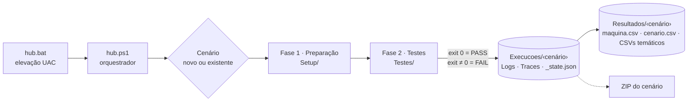

<div align="center">

# Hardware Test Hub

**Framework para validação de hardware em máquinas Windows.**<br>
Prepara o ambiente, executa testes de CPU, memória, disco, rede, boot, bateria e Wi-Fi e gera relatórios rastreáveis por cenário.

[](https://github.com/AndreRenatoMenezes/win_testehub/actions/workflows/ci.yml)
[](https://github.com/AndreRenatoMenezes/win_testehub/releases)


[Início rápido](#início-rápido) · [Módulos](#módulos-de-teste) · [Saídas](#saídas-e-relatórios) · [Documentação](#documentação) · [Contribuir](CONTRIBUTING.md)

</div>

---

## Sobre

O **Hardware Test Hub** padroniza a homologação de notebooks e desktops Windows. Um único ponto de entrada (`hub.bat`) eleva os privilégios, prepara a máquina e abre um menu no console onde o operador escolhe os testes. Cada teste é um script independente, que devolve PASS/FAIL pelo exit code e grava evidências numa pasta controlada pelo hub.

Os resultados ficam agrupados em **cenários** (por exemplo, `ImagemLimpa` × `ComAgentes`). Assim dá para comparar a mesma máquina em configurações diferentes, retomar uma bateria de testes em outro dia e reexecutar só o que falhou, sem perder nenhuma evidência.

### Destaques

- **Menu interativo**: seleção múltipla por setas e espaço. Os testes pendentes já vêm marcados, `A` marca todos e `P` volta a marcar só os pendentes.
- **Duas fases**: preparação da máquina (energia, Windows Update, Python, bloatware…) e testes de hardware.
- **Cenários persistentes**: o histórico de execuções fica em `_state.json`. Numa reexecução, as evidências anteriores vão para `_anterior/` em vez de serem sobrescritas.
- **Relatórios em vários formatos**: HTML, CSV, JSON e log completo, por execução e consolidados por cenário, além de CSVs temáticos prontos para BI.
- **Extensível por convenção**: qualquer `.py` ou `.ps1` colocado em `Testes/` vira um item do menu.
- **Feito para o operador**: overlays de progresso que não capturam cliques, parada segura com `Ctrl+Q` e exportação do cenário para ZIP validado.

## Módulos de teste

| # | Módulo | Script | O que mede | Duração | PASS quando |
|:-:|--------|--------|------------|:-------:|-------------|
| 1 | CPU e Memória | `1_automacao_performance.py` | Carga de escritório no Edge (Docs, Sheets e PDF) com captura WPR e exportação WPA: 5 ciclos de 5 min com cooldown inteligente | ~50 min | os 5 ciclos terminam sem erro |
| 1.1 | CPU e Memória — DLP/USB | `1-1_automacao_performance_dlp.py` | Variante do Módulo 1: cópias para pendrive durante a captura, para medir o custo do agente de DLP | 5 ciclos de 60 s | os ciclos terminam sem erro |
| 2 | Disco | `2_teste_disco.py` | Leitura e escrita sequenciais com DiskSpd (bloco de 1 MB, arquivo de 8 GB), 10 baterias | ~25 min | as 10 baterias terminam e o CSV é gerado |
| 2.1 | Disco — DLP/USB | `2-1_teste_disco_dlp.py` | Cópia PC ↔ pendrive de um arquivo de 2 GB, 5 baterias | 5 baterias | as baterias terminam sem erro |
| 3 | Rede (interna) | `3_teste_rede.py` | Download, upload, ping e jitter num speedtest interno, 5 aferições | ~6 min | as 5 aferições são capturadas |
| 3.1 | Rede (internet) | `3-1_teste_rede_internet.py` | As mesmas métricas no fast.com, pelo caminho real do tráfego (proxy/zero trust), mais o IP público de saída | ~3 min | as 5 aferições são válidas |
| 4 | Boot e Shutdown | `4_boot_shutdown_auto.py` | 5 reinícios automáticos e análise dos eventos 100/200 do `Diagnostics-Performance` | ~30–40 min | nenhum boot ou shutdown crítico (> 60 s) no dia |
| 5 | Bateria | `5_teste_bateria.py` | 60 min ociosa + 60 min de escritório na bateria, com pré-voo de padronização, WPR, SRUM e relatório de energia | ~2h20–2h40 | a coleta é válida nas duas fases |
| 6 | Wi-Fi Fast Transition | `6_teste_fast_transition.py` | Roaming 802.11r durante uma caminhada de 5 min, com painel ao vivo e inventário de APs | ~7 min | ≥ 1 troca de AP com FT |

> Os módulos 5 e 6 precisam de um operador presente: desconectar o carregador, no 5, e andar com o notebook, no 6. O passo a passo está no [manual](docs/manual-de-execucao.md#46-teste-de-bateria-módulo-5--passo-a-passo-do-operador).

<details>
<summary><b>Scripts de preparação (Fase 1)</b></summary>

| Script | O que faz |
|--------|-----------|
| `1_captura_infos_pc.ps1` | Inventário de CPU, RAM, discos, bateria (saúde e ciclos), SO e BIOS em `informacoes_maquina.csv` |
| `2_opcoes_energia.ps1` | Plano Equilibrado, sem suspensão e sem desligar a tela; fechar a tampa não faz nada |
| `3_softwares_msStore.ps1` | Instala via winget o Windows ADK, o CrystalDiskMark e o CrystalDiskInfo |
| `4_install_python.ps1` | Instala o Python 3.12 oficial, remove o alias da Microsoft Store e atualiza pip, wheel e setuptools |
| `5_install_py_dependencies.ps1` | Cria o `.venv` e instala as dependências dos testes |
| `6_pausa_WinUpdate.ps1` | Pausa o Windows Update por 35 dias |
| `8_enable_diagnostics.ps1` | Desliga a Inicialização Rápida e habilita DPS, SysMain e a política WDI (eventos de boot/shutdown) |
| `9_AdicionarTecladoUSInt.ps1` | Adiciona o teclado EUA-Internacional ao idioma pt-BR |
| `12_remover_appx_bloatware.ps1` | Remove Xbox, Copilot, Teams, Notícias, Solitaire, LinkedIn, WhatsApp e To Do |
| `13_remover_onedrive.ps1` | Desinstala o OneDrive e bloqueia a reinstalação por política |

</details>

## Arquitetura



Antes de cada script, o hub injeta `HUB_EVIDENCE_DIR` (onde gravar as evidências) e `HUB_TRACE_ROOT` (a raiz do cenário). Toda a saída é capturada para o log da execução. O contrato completo está no [CONTRIBUTING.md](CONTRIBUTING.md#contrato-de-um-script).

## Requisitos

| Item | Detalhe |
|------|---------|
| Sistema | Windows 10 ou 11, com acesso de **administrador** local |
| Rede | Internet para o setup; acesso ao speedtest interno para o Módulo 3 |
| Disco | ≥ 10 GB livres (o Módulo 2 cria um arquivo de teste de 8 GB) |
| Software | Python 3.12 e as dependências são instalados pelo próprio setup. O Microsoft Edge já vem no Windows |
| Módulos 1 e 5 | Windows Performance Toolkit (`wpr.exe` e `wpaexporter.exe`) no `PATH`, parte do Windows ADK; Edge com a conta Google logada |
| Módulo 3 | `config.local.json` com a URL do speedtest interno (veja [Configuração](#configuração)) |
| Módulos 1.1 e 2.1 | Pendrive montado como `E:\` (configurável no topo de cada script) |
| Módulo 5 | Notebook com bateria reconhecida e carregada a ≥ 95% |
| Módulo 6 | Wi-Fi conectado à rede testada, com 2 ou mais APs do mesmo SSID no percurso |

## Início rápido

```powershell
# 1. Clone em C:\TesteHub (caminho esperado pelo hub.bat)
git clone https://github.com/AndreRenatoMenezes/win_testehub.git C:\TesteHub
cd C:\TesteHub

# 2. Crie a configuração local (não versionada) e informe a URL do speedtest interno
Copy-Item config.local.example.json config.local.json
notepad config.local.json
```

3. Copie os perfis WPA internos para as pastas dos módulos 1 e 5 (veja [Arquivos não versionados](#arquivos-não-versionados)).
4. Dê dois cliques em **`hub.bat`** e aceite o UAC.
5. Na primeira execução, crie um cenário (`N`), marque **todos** os scripts de preparação (`A`) e confirme com `Enter`.
6. Na fase de testes, escolha os módulos e acompanhe o progresso no console.

<details>
<summary>Executar direto pelo PowerShell (já como administrador)</summary>

```powershell
powershell.exe -NoProfile -ExecutionPolicy Bypass -File C:\TesteHub\hub.ps1
```

</details>

### Controles do menu

| Tecla | Ação |
|:-----:|------|
| `↑` `↓` | Navegar |
| `Espaço` | Marcar ou desmarcar |
| `A` | Marcar ou desmarcar todos |
| `P` | Marcar só os pendentes (nunca executados no cenário) |
| `Enter` | Confirmar |
| `Esc` | Cancelar |

## Configuração

### `config.json` (versionado)

| Chave | Padrão | Descrição |
|-------|--------|-----------|
| `SkipSetup` | `false` | `true` pula a Fase 1 e vai direto para os testes |
| `Paths.SetupRoot` | `Setup` | Pasta dos scripts de preparação |
| `Paths.TestsRoot` | `Testes` | Pasta dos módulos de teste |
| `Paths.ExecucoesDir` | `Execucoes` | Logs, traces e estado de cada cenário |
| `Paths.ResultadosDir` | `Resultados` | Resultados estruturados (CSVs) de cada cenário |
| `Settings.PythonVenvName` | `.venv` | Ambiente virtual usado para os testes `.py` |
| `Settings.HtmlReportTitle` | `Hardware Test Hub - Relatório Final` | Título dos relatórios HTML |

### `config.local.json` (não versionado)

Guarda os valores internos do ambiente. Use o [`config.local.example.json`](config.local.example.json) como modelo.

| Chave | Variável de ambiente equivalente | Uso |
|-------|----------------------------------|-----|
| `SpeedtestUrl` | `HUB_SPEEDTEST_URL` (tem prioridade) | URL do speedtest interno usado no Módulo 3 |

### Arquivos não versionados

Por segurança ou por licença, alguns arquivos ficam fora do Git e são distribuídos internamente. O CI bloqueia commits que os incluam.

| Arquivo | Onde colocar | Motivo | Sem ele |
|---------|--------------|--------|---------|
| `config.local.json` | raiz | Contém a URL interna do speedtest | O Módulo 3 falha com uma mensagem de configuração |
| `Agentes_SI_Profile.wpaProfile` | `Testes/1_cpu_memo/` | Lista os processos dos agentes monitorados | O trace WPR é capturado, mas a exportação CSV é pulada |
| `Agentes_SI_Bateria_Profile.wpaProfile` | `Testes/5_bateria/` | Mesmo motivo, no Módulo 5 | Idem |
| `msedgedriver.exe` *(opcional)* | `Testes/1_cpu_memo/` | A licença não permite redistribuição | O Selenium Manager baixa o driver compatível sozinho |

## Saídas e relatórios

```text
Execucoes/
└── ImagemLimpa_DESKTOP-ABC_2026-04-15/      # {cenário}_{hostname}_{data}
    ├── Logs/
    │   ├── run_20260415_093000.log          # saída completa de cada script
    │   └── run_20260415_093000.{html,csv,json}
    └── Traces/
        ├── _state.json                      # histórico de todas as execuções
        ├── _relatorio.{html,csv,json}       # consolidado: último status de cada teste
        ├── informacoes_maquina.csv          # inventário do setup 1
        └── 2_disco/                         # evidências de cada teste
            └── _anterior/run1_…/            # evidências substituídas numa reexecução
Resultados/
└── ImagemLimpa_DESKTOP-ABC_2026-04-15/
    ├── maquina.csv                          # modelo, série, CPU, RAM, disco, SO
    ├── cenario.csv                          # status consolidado do cenário
    ├── cpu_memoria.csv, disco.csv, rede.csv, rede_internet.csv,
    │   boot_shutdown.csv, bateria.csv, wifi_ft.csv
    └── cpu_memoria_dlp.csv, disco_usb.csv   # variantes 1.1 e 2.1, quando executadas
```

| Preciso de… | Use |
|-------------|-----|
| Apresentar o resultado | `Traces/_relatorio.html` |
| Alimentar planilha ou BI | `Resultados/<cenário>/*.csv` |
| Auditar uma execução | `Logs/run_*.json` |
| Investigar uma falha | `Logs/run_*.log` e a pasta de evidências do teste |

No menu inicial, a opção **`E`** compacta um cenário em ZIP, confere a contagem de arquivos e só então remove a pasta original.

## Estrutura do repositório

```text
.
├── hub.bat                    # ponto de entrada (eleva para administrador)
├── hub.ps1                    # orquestrador: menu, execução, estado e relatórios
├── config.json                # configuração versionada
├── config.local.example.json  # modelo da configuração local (não versionada)
├── Setup/environment/         # scripts da Fase 1
├── Testes/                    # um módulo por pasta (N_categoria/)
│   ├── 1_cpu_memo/
│   ├── 2_disco/               # inclui diskspd.exe (MIT)
│   ├── 3_rede/
│   ├── 3_rede_internet/
│   ├── 4_boot_shutdown/
│   ├── 5_bateria/
│   └── 6_wifi_fast_transition/
├── docs/                      # manual e metodologia (.md = fonte; .html gerado por gerar_html.py)
└── .github/                   # CI, Dependabot e modelos de issue e de PR
```

## Adicionando um novo teste

1. Crie `Testes/7_categoria/7_meu_teste.py` (ou `.ps1`).
2. Grave as evidências em `os.environ["HUB_EVIDENCE_DIR"]`.
3. Saia com `0` para PASS e com qualquer outro código para FAIL.

O hub encontra o script sozinho. Para regras de CSV temático, scripts auxiliares e o checklist completo, veja o [CONTRIBUTING.md](CONTRIBUTING.md).

## Documentação

| Documento | Público | Conteúdo |
|-----------|---------|----------|
| [Manual de execução](docs/manual-de-execucao.md) | Operadores e equipe técnica | Instalação, passo a passo por módulo, re-execução e troubleshooting |
| [Metodologia de testes](docs/metodologia-de-testes.md) | Equipe técnica, gestão e auditoria | Objetivo, procedimento, métricas e critério de aprovação de cada módulo |

As versões `.html` em `docs/` são as mesmas páginas, para leitura offline ou impressão. Elas são **geradas** a partir dos `.md` e não devem ser editadas à mão: depois de alterar um `.md`, rode `python docs/gerar_html.py` (requer `pip install markdown`). O CI falha se os dois formatos divergirem.

## Contribuindo

Contribuições são bem-vindas. Leia o [CONTRIBUTING.md](CONTRIBUTING.md) e abra uma [issue](https://github.com/AndreRenatoMenezes/win_testehub/issues/new/choose) antes de começar mudanças grandes. As mudanças de cada versão ficam no [CHANGELOG.md](CHANGELOG.md).

## Licença

Este projeto **não** tem licença de código aberto: todos os direitos são reservados. Os componentes de terceiros redistribuídos aqui seguem suas próprias licenças (veja [THIRD_PARTY_NOTICES.md](THIRD_PARTY_NOTICES.md)).

---

<div align="center">
Desenvolvido por <a href="https://github.com/AndreRenatoMenezes">Andre Renato Menezes</a>
</div>
